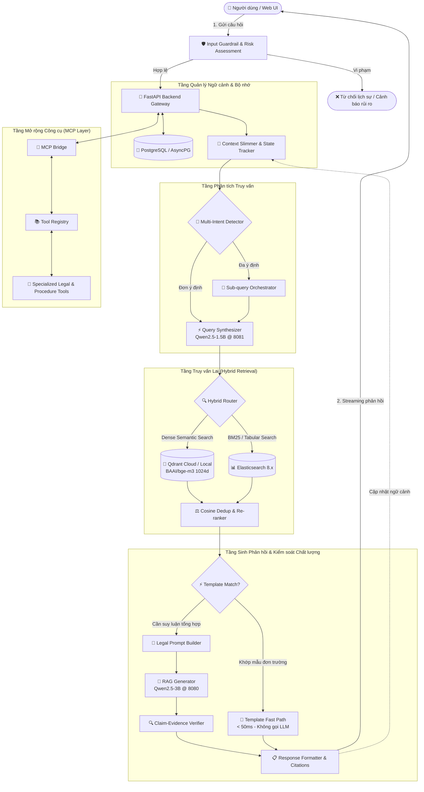

# 🏛️ LLM Administrative Procedures & Multi-Domain RAG Assistant

> **Hệ thống Trợ lý Pháp lý & Thủ tục Hành chính Thông minh ứng dụng Mô hình Ngôn ngữ Lớn (LLM), Kỹ thuật Truy vấn Lai Đa tầng (Hybrid Retrieval: Qdrant + Elasticsearch), Điều phối Đa ý định (Multi-Intent Orchestration) và Giao thức Model Context Protocol (MCP).**

[](https://www.python.org/)
[](https://fastapi.tiangolo.com/)
[](https://qdrant.tech/)
[](https://www.elastic.co/)
[](https://www.postgresql.org/)
[-FF6F00.svg?style=flat)](https://github.com/ggerganov/llama.cpp)
[](https://huggingface.co/BAAI/bge-m3)
[](https://opensource.org/licenses/MIT)

---

## 📑 Mục Lục
- [📂 Kiến trúc Monorepo & 2 Phân hệ Độc lập](#-kiến-trúc-monorepo--2-phân-hệ-độc-lập)
- [📖 Giới thiệu Dự án](#-giới-thiệu-dự-án)
- [✨ Tính năng Cốt lõi](#-tính-năng-cốt-lõi)
- [🏗️ Sơ đồ Kiến trúc Hệ thống (System Architecture)](#️-kiến-trúc-hệ-thống-system-architecture)
- [🧠 Thông tin Mô hình & Phân tích Kỹ thuật Lượng tử hóa](#-thông-tin-mô-hình--phân-tích-kỹ-thuật-lượng-tử-hóa)
- [📁 Cấu trúc Thư mục Repository](#-cấu-trúc-thư-mục-repository)
- [💻 Yêu cầu Hệ thống (Prerequisites)](#-yêu-cầu-hệ-thống-prerequisites)
- [🛠️ Hướng dẫn Cài đặt & Khởi chạy Nhanh](#️-hướng-dẫn-cài-đặt--khởi-chạy-nhanh)
  - [Cách 1: Khởi chạy Phân hệ Đa Domain (`multi_domain_system` @ 8002)](#cách-1-khởi-chạy-phân-hệ-đa-domain-multi_domain_system--8002)
  - [Cách 2: Khởi chạy Bản Độc lập Thủ tục Hành chính (`administrative_procedures_standalone` @ 8003)](#cách-2-khởi-chạy-bản-độc-lập-thủ-tục-hành-chính-administrative_procedures_standalone--8003)
- [📡 Danh mục API & WebSocket Reference](#-danh-mục-api--websocket-reference)
- [🧰 Tech Stack Chi tiết](#-tech-stack-chi-tiết)
- [📊 Đánh giá Thực nghiệm (Evaluation & Benchmarks)](#-đánh-giá-thực-nghiệm-evaluation--benchmarks)
- [⚠️ Hạn chế Đã biết & Lộ trình Phát triển (Roadmap)](#️-hạn-chế-đã-biết--lộ-trình-phát-triển-roadmap)
- [📄 Bản quyền (License)](#-bản-quyền-license)

---

## 📂 Kiến trúc Monorepo & 2 Phân hệ Độc lập

Kho mã nguồn được cấu trúc theo mô hình **Monorepo chuẩn hóa**, tách biệt rõ ràng giữa môi trường nghiên cứu/mở rộng đa lĩnh vực và môi trường triển khai thực tế chuyên sâu:

| Tiêu chí | Phân hệ 1: Hệ thống Đa Domain ([`multi_domain_system/`](multi_domain_system/)) | Phân hệ 2: Bản Độc lập Thủ tục Hành chính ([`administrative_procedures_standalone/`](administrative_procedures_standalone/)) |
|:---|:---|:---|
| **Mục đích** | Hệ sinh thái mở rộng linh hoạt, nghiên cứu & triển khai đa tri thức | Bản đóng gói khép kín, sẵn sàng đưa vào vận hành tại các cơ quan một cửa |
| **Cổng phục vụ** | **`8002`** (FastAPI + Web UI Đa Domain) | **`8003`** (FastAPI + Web UI Chuyên biệt Thủ tục công) |
| **Phạm vi Domain** | Đa lĩnh vực: Thủ tục hành chính, Ẩm thực, Nấu ăn, Du lịch & Domain động | Duy nhất: 1.298 Thủ tục Hành chính Công TP.HCM (**Strict Mode**) |
| **Cơ chế Truy vấn** | Hybrid Search (Qdrant Dense Vector + Elasticsearch BM25) + Multi-Intent | Hybrid Qdrant + **Template Fast Path (<50ms)** bypass LLM cho câu hỏi đơn trường |
| **Mở rộng Công cụ** | Tích hợp giao thức **Model Context Protocol (MCP)** đa tầng | Bộ Guardrails 3 tầng khép kín, không phụ thuộc ngoại vi |
| **Độ độc lập** | Chạy độc lập trong `multi_domain_system/`, sở hữu model riêng | Độc lập 100%, có thể copy/cut sang máy tính khác là chạy được ngay |

---

## 📖 Giới thiệu Dự án

**LLM Administrative Procedures** là nền tảng trợ lý thông minh hỗ trợ công dân, cán bộ công chức và doanh nghiệp tra cứu, giải đáp thắc mắc về các thủ tục hành chính công tại Việt Nam (hồ sơ, trình tự thực hiện, thời hạn giải quyết, cơ quan thẩm quyền, lệ phí và căn cứ pháp lý).

Hệ thống giải quyết triệt để vấn đề "ảo giác" (hallucination) của các mô hình ngôn ngữ lớn thông thường bằng cách:
1. **Truy xuất Căn cứ Pháp lý Chính xác**: Chỉ trả lời dựa trên các đoạn trích dẫn được retriever tìm thấy từ cơ sở dữ liệu pháp điển đã kiểm chứng.
2. **Template Fast Path**: Với các câu hỏi đơn trường (ví dụ: *"Lệ phí làm hộ chiếu là bao nhiêu?"*), hệ thống trích xuất trực tiếp từ trường dữ liệu có cấu trúc và phản hồi ngay lập tức, bỏ qua hoàn toàn bước sinh văn bản tự do của LLM.
3. **Đối Soát Luận Điểm Đa Tầng (Claim-Evidence Verification)**: Toàn bộ câu trả lời sinh ra bởi LLM được đối soát từng câu với tài liệu nguồn trước khi truyền phát về máy người dùng.

---

## ✨ Tính năng Cốt lõi

- **🔍 Truy vấn Lai Đa Tầng (Hybrid Retrieval & Re-ranking)**: Kết hợp vector ngữ nghĩa sâu 1024 chiều của **`BAAI/bge-m3`** trên **Qdrant** và tìm kiếm từ khóa chính xác **BM25** trên **Elasticsearch**, đi kèm thuật toán chấm điểm và sắp xếp lại kết quả (Re-ranking).
- **⚡ Template Fast Path & Rule-based Query Synthesis**: Phản hồi tức thì trong vòng **<50ms** cho các câu hỏi tra cứu trường thông tin cố định, tiết kiệm tài nguyên tính toán và chống ảo giác tuyệt đối.
- **🎯 Xử lý Đa Ý định (Multi-Intent Detection & Orchestration)**: Tự động phân tích câu hỏi phức hợp của người dùng thành các truy vấn con độc lập, thực hiện truy vấn song song và tổng hợp thành câu trả lời mạch lạc.
- **💬 Quản lý Ngữ cảnh Đa Lượt & Context Slimming**: Lưu trữ lịch sử phiên trên **PostgreSQL (`AsyncPG`)**, tự động tóm tắt ngữ cảnh dài và áp dụng thuật toán cắt tỉa token (`SLIM_CONTEXT`) để giữ vững chất lượng lập luận của LLM qua hàng chục lượt trò chuyện liên tiếp.
- **📦 AI Chunk Planner & Pipeline Nạp Đa Định dạng**: Tự động nhận diện cấu trúc tệp (JSON, CSV, XLSX, PDF, DOCX, Web), đề xuất chiến lược chunking tối ưu, khử trùng lặp (SHA-256 + Cosine Similarity) và lưu trữ hash phiên bản theo relative path.
- **🛡️ Bộ Lọc An toàn 3 Lớp (Guardrails Layer)**:
  - *Input Guardrails*: Phát hiện và ngăn chặn Prompt Injection, lọc câu hỏi lạc đề hoặc phi pháp lý.
  - *Legal Risk Assessment*: Phân loại mức độ rủi ro (thủ tục nhạy cảm, khiếu nại, tranh chấp đất đai).
  - *Output Claim Verification*: Kiểm chứng từng luận cứ trong văn bản trả lời trước khi gửi đến người dùng.
- **🔌 Model Context Protocol (MCP)**: Thiết kế phân tầng (Client – Registry – Tools) giúp cắm/rút linh hoạt các công cụ tra cứu văn bản quy phạm pháp luật và dịch vụ công quốc gia.
- **💻 Giao diện Web UI Hiện đại**: Web UI SPA tích hợp sẵn hỗ trợ truyền phát câu trả lời dạng Streaming (WebSocket), hiển thị Citation Cards kèm độ tin cậy, quản lý phiên và giao diện nạp dữ liệu trực quan.

---

## 🏗️ Sơ đồ Kiến trúc Hệ thống (System Architecture)



---

## 🧠 Thông tin Mô hình & Phân tích Kỹ thuật Lượng tử hóa

Hệ thống ứng dụng kiến trúc **Dual-Model** (hai mô hình chuyên biệt hóa theo tác vụ) nhằm tối ưu hóa đồng thời tốc độ phản hồi và chất lượng lập luận:

### 1. Bảng Tổng quan Mô hình

| Mô hình | Định dạng | Vai trò trong Hệ thống | Số Tham số | Context Window | Cổng Dịch vụ | Cơ chế Khởi chạy |
|:---|:---:|:---|:---:|:---:|:---:|:---:|
| **Qwen2.5-3B-Instruct** | GGUF (`Q4_K_M`) | **RAG Generator**: Lập luận pháp lý, tổng hợp tài liệu và sinh câu trả lời kèm dẫn chứng | ~3.09 tỷ (3.09B) | 4,096 tokens | `8080` | **Tự động khởi chạy** qua FastAPI Lifespan |
| **Qwen2.5-1.5B-Instruct** | GGUF (`Q4_K_M`) | **Query Synthesizer**: Phân tích lịch sử, bóc tách thực thể và tái cấu trúc câu hỏi | ~1.54 tỷ (1.54B) | 2,048 tokens | `8081` | **Tự động khởi chạy** qua FastAPI Lifespan |
| **BAAI/bge-m3** | PyTorch / HF | **Embedding Model**: Chuyển đổi văn bản thành vector đặc trưng đa ngữ 1024 chiều | ~568 triệu (568M) | 8,192 tokens | Cục bộ (In-memory) | Tải qua Singleton Provider |

---

### 2. Phân tích Kỹ thuật: Mô hình Lượng tử hóa Q4_K_M vs Mô hình Gốc (FP16)

Hệ thống sử dụng kỹ thuật lượng tử hóa **Q4_K_M** (4-bit Medium K-Quant) thông qua định dạng GGUF của `llama.cpp` để chạy trực tiếp trên máy chủ hoặc máy tính cá nhân:

| Tiêu chí So sánh | Mô hình Gốc (FP16 / BF16) | Lượng tử hóa Q4_K_M (Đang triển khai) | Mức độ Thay đổi & Nhận xét |
|:---|:---:|:---:|:---|
| **Độ chính xác lưu trữ** | 16-bit floating point (2 bytes/tham số) | Kết hợp 4-bit & 6-bit (trung bình ~4.5 bits/tham số) | Giảm **~72%** số bit biểu diễn mỗi trọng số |
| **Dung lượng File Model (3B)** | ~6.20 GB | **~1.84 GB** | **Giảm 70.3%** dung lượng ổ cứng lưu trữ |
| **Dung lượng File Model (1.5B)** | ~3.10 GB | **~0.94 GB** | **Giảm 69.7%** dung lượng ổ cứng lưu trữ |
| **Dung lượng RAM tối thiểu** | 12 – 16 GB VRAM/RAM | **~4 GB RAM** (cho cả 2 models) | Chạy mượt mà trên môi trường CPU không có GPU rời |
| **Bảo toàn Chất lượng (Accuracy)** | 100% (Mốc chuẩn gốc) | **98.0% – 99.2%** năng lực gốc | Chỉ số Perplexity chỉ tăng nhẹ (~0.05 - 0.12 PPL), sai số không đáng kể |
| **Tốc độ Suy luận trên CPU** | Chậm (nghẽn băng thông nạp trọng số) | **Nhanh gấp 2 – 3 lần** trên CPU | Băng thông bộ nhớ được giải phóng vì lượng dữ liệu cần nạp ít hơn gần 4 lần |
| **Độ tuân thủ JSON/Schema** | Xuất sắc | Xuất sắc | Các tầng trọng số điều khiển attention được giữ ở mức 6-bit nên không bị vỡ định dạng cấu trúc |

#### 🔍 Cơ chế Hoạt động của Q4_K_M trong Bài toán RAG:
- Phương pháp **K-Quant Medium (`Q4_K_M`)** áp dụng chiến lược phân bổ bit thích ứng: Các ma trận trọng số ảnh hưởng quyết định đến khả năng chú ý và suy luận logic (`attention.wv`, `attention.wo` và các tầng feed-forward then chốt) được giữ ở mức **6-bit (`Q6_K`)**, các ma trận ít nhạy cảm hơn được biểu diễn ở mức **4-bit (`Q4_K`)**.
- Trong kiến trúc RAG, toàn bộ căn cứ pháp lý đã được bộ tìm kiếm lai trích xuất và đưa trực tiếp vào context prompt. Mô hình chủ yếu thực hiện tác vụ đọc hiểu (reading comprehension) và đối chiếu thông tin. Vì vậy, **Q4_K_M mang lại kết quả chính xác tương đương 99% so với FP16**, đồng thời tiết kiệm hơn 70% bộ nhớ RAM.

---

## 📁 Cấu trúc Thư mục Repository

```
LLM_Administrative_Procedures/ (Root Repository)
│
├── .git/                                         # Quản lý phiên bản Git
├── .gitignore                                    # Cấu hình bỏ qua toàn cục (bảo mật secrets & weights)
├── README.md                                     # Tài liệu tổng quan dự án (tài liệu này)
├── LICENSE                                       # Giấy phép mã nguồn mở (MIT)
│
├── multi_domain_system/                          # [PHÂN HỆ 1] HỆ THỐNG ĐA DOMAIN (PORT 8002)
│   ├── backend/                                  # FastAPI server & API routers
│   │   ├── api/                                  # Routers: chat, sessions, ingestion, socket
│   │   ├── services/                             # AI service, Context service, Queue service
│   │   └── main.py                               # Khởi chạy server & Auto-spawn llama-server
│   ├── domains/                                  # Registry domain động (Thủ tục, Ẩm thực, Nấu ăn, Du lịch)
│   ├── rag/                                      # Pipeline RAG đa domain, Multi-intent router, Reranker
│   ├── ingestion/                                # Ingestion đa định dạng, AI Chunk Planner, relative versioning
│   ├── context/                                  # Quản lý phiên & Context Slimming với PostgreSQL
│   ├── guardrails/                               # Bộ lọc an toàn đầu vào, rủi ro pháp lý & đối soát đầu ra
│   ├── mcp_layer/                                # Giao thức Model Context Protocol (MCP) bridges & tools
│   ├── model/                                    # Trọng số GGUF (Qwen2.5-3B và 1.5B)
│   ├── data/                                     # Dữ liệu nguồn (.json, .xlsx, .csv) & version tracker
│   ├── ui/                                       # Giao diện Web UI đa domain (HTML, CSS, JS)
│   ├── benchmark/ & scripts/                     # Bộ benchmark latency & kịch bản bảo trì
│   ├── tests_*/                                  # Test suites tự động
│   ├── my_config.py                              # File cấu hình độc lập của phân hệ
│   ├── requirements.txt                          # Danh sách thư viện Python của phân hệ
│   ├── .env.example                              # File cấu hình mẫu
│   └── README.md                                 # Hướng dẫn chi tiết phân hệ đa domain
│
└── administrative_procedures_standalone/         # [PHÂN HỆ 2] BẢN ĐỘC LẬP THỦ TỤC HÀNH CHÍNH (PORT 8003)
    ├── backend/                                  # FastAPI server chuyên biệt (Port 8003)
    ├── domains/                                  # Domain duy nhất: administrative_procedures
    ├── rag/                                      # Pipeline RAG chuyên biệt hóa (Template Fast Path <50ms)
    ├── ingestion/                                # Ingestion chuyên biệt 1.298 thủ tục hành chính
    ├── context/                                  # Database & context service PostgreSQL
    ├── guardrails/                               # Bộ lọc an toàn thủ tục công (Strict Mode)
    ├── model/                                    # Trọng số GGUF cục bộ (Qwen 3B và 1.5B)
    ├── data/                                     # procedures.json & .ingestion_versions.json độc lập
    ├── ui/                                       # Web UI chuyên biệt cho tra cứu thủ tục công
    ├── my_config.py                              # File cấu hình độc lập phân hệ
    ├── requirements.txt                          # Danh sách thư viện Python độc lập
    ├── .env.example                              # File cấu hình mẫu
    └── README.md                                 # Hướng dẫn chi tiết bản độc lập
```

---

## 💻 Yêu cầu Hệ thống (Prerequisites)

- **Hệ điều hành**: Windows 10/11, macOS, hoặc Linux (Ubuntu 20.04 trở lên).
- **Python**: Phiên bản **`Python 3.12.x`** *(Khuyến nghị dùng `py -3.12` trên Windows)*.
- **Vector Database**: Cụm **Qdrant Cloud** (miễn phí hoặc tự host) hoặc chạy Qdrant Local.
- **Relational Database**: **PostgreSQL** (PostgreSQL 14+ cục bộ hoặc Supabase Cloud).
- **Elasticsearch (Tuỳ chọn cho phân hệ đa domain)**: Elasticsearch 8.x (chạy qua Docker).
- **Phần cứng khuyến nghị**:
  - RAM: Tối thiểu 8 GB (Khuyến nghị **16 GB** để chạy đồng thời cả hai mô hình LLM và backend).
  - Ổ cứng: Trống tối thiểu **10 GB** cho các tệp trọng số GGUF và bộ nhớ đệm embeddings.

---

## 🛠️ Hướng dẫn Cài đặt & Khởi chạy Nhanh

### Bước 1: Sao chép Mã nguồn (Clone Repository)
```bash
git clone https://github.com/your-username/LLM_Administrative_Procedures.git
cd LLM_Administrative_Procedures
```

### Bước 2: Tải Trọng số Mô hình GGUF
Hệ thống sử dụng 2 mô hình GGUF phiên bản lượng tử hóa `Q4_K_M` từ Hugging Face:
- [`Qwen2.5-3B-Instruct-Q4_K_M.gguf`](https://huggingface.co/Qwen/Qwen2.5-3B-Instruct-GGUF) (~1.84 GB)
- [`Qwen2.5-1.5B-Instruct-Q4_K_M.gguf`](https://huggingface.co/Qwen/Qwen2.5-1.5B-Instruct-GGUF) (~940 MB)

*(Đặt file vào thư mục `model/` của phân hệ bạn muốn khởi chạy).*

---

### Cách 1: Khởi chạy Phân hệ Đa Domain (`multi_domain_system` @ 8002)

1. **Di chuyển vào thư mục và kích hoạt môi trường ảo**:
   ```bash
   cd multi_domain_system
   py -3.12 -m venv .venv

   # Windows:
   .venv\Scripts\activate
   # Linux/macOS:
   source .venv/bin/activate
   ```

2. **Cài đặt thư viện**:
   ```bash
   pip install --upgrade pip
   pip install -r requirements.txt
   ```

3. **Cấu hình biến môi trường**:
   ```bash
   cp .env.example .env
   ```
   *Mở `.env` và điền `DATABASE_URL` (PostgreSQL), `QDRANT_URL`, `QDRANT_API_KEY`.*

4. **Khởi chạy ứng dụng**:
   ```bash
   py -3.12 backend/main.py
   ```
   > 💡 **Tự động khởi động llama-server**: Hệ thống sẽ tự động kích hoạt `llama-server` cho mô hình 3B (cổng `8080`) và mô hình 1.5B (cổng `8081`).
   
   - **Giao diện Web UI**: Truy cập `http://127.0.0.1:8002`
   - **Tài liệu API (Swagger UI)**: Truy cập `http://127.0.0.1:8002/docs`

---

### Cách 2: Khởi chạy Bản Độc lập Thủ tục Hành chính (`administrative_procedures_standalone` @ 8003)

1. **Di chuyển vào thư mục và kích hoạt môi trường ảo**:
   ```bash
   cd administrative_procedures_standalone
   py -3.12 -m venv .venv

   # Windows:
   .venv\Scripts\activate
   # Linux/macOS:
   source .venv/bin/activate
   ```

2. **Cài đặt thư viện**:
   ```bash
   pip install --upgrade pip
   pip install -r requirements.txt
   ```

3. **Cấu hình biến môi trường**:
   ```bash
   cp .env.example .env
   ```
   *Mở `.env` và điền `DATABASE_URL`, `QDRANT_URL`, `QDRANT_API_KEY`.*

4. **Khởi chạy ứng dụng**:
   ```bash
   py -3.12 backend/main.py
   ```
   - **Giao diện Web UI**: Truy cập `http://127.0.0.1:8003`
   - **Tài liệu API (Swagger UI)**: Truy cập `http://127.0.0.1:8003/docs`

---

## 📡 Danh mục API & WebSocket Reference

Tài liệu API tương tác được cung cấp tự động qua Swagger UI tại `/docs` của mỗi phân hệ.

### Bảng Endpoints Thực tế:

| Phương thức | Endpoint | Giao thức | Mô tả Chức năng |
|:---:|:---|:---:|:---|
| `POST` | `/api/chat` | HTTP REST | Gửi câu hỏi tra cứu; nhận câu trả lời kèm trích dẫn văn bản, căn cứ pháp lý và điểm tin cậy |
| `WS` | `/ws/chat` | WebSocket | Kênh hội thoại truyền phát thời gian thực (Token Streaming) kèm phản hồi trạng thái |
| `GET` | `/api/session/bootstrap` | HTTP REST | Tự động tạo hoặc khôi phục `session_id` ẩn danh thông qua Cookie |
| `GET` | `/api/sessions` | HTTP REST | Lấy danh sách các phiên hội thoại của người dùng |
| `GET` | `/api/sessions/{session_id}/messages` | HTTP REST | Truy xuất toàn bộ lịch sử tin nhắn và ngữ cảnh của một phiên cụ thể |
| `DELETE` | `/api/sessions/{session_id}` | HTTP REST | Xóa lịch sử và giải phóng bộ nhớ ngữ cảnh của phiên |
| `GET` | `/api/domains` | HTTP REST | Lấy danh sách các domain tri thức đang kích hoạt trong hệ thống |
| `POST` | `/api/domains/create` | HTTP REST | (*multi_domain_system*) Tạo mới một domain tri thức động qua giao diện |
| `POST` | `/api/ingest` | HTTP REST | Nạp tài liệu dữ liệu mới (JSON, CSV, XLSX, PDF, DOCX, Web) vào hệ thống |
| `POST` | `/api/ingest/preview-plan` | HTTP REST | (*AI Chunk Planner*) Phân tích trước cấu trúc file và trả về chiến lược phân mảnh tối ưu |
| `GET` | `/health` | HTTP REST | Kiểm tra sức khỏe hệ thống (Health Check) |
| `GET` | `/api/system/status` | HTTP REST | Báo cáo trạng thái sẵn sàng của 2 mô hình LLM và các kết nối cơ sở dữ liệu |

#### Ví dụ Gửi Câu hỏi (cURL):
```bash
curl -X POST "http://127.0.0.1:8002/api/chat" \
     -H "Content-Type: application/json" \
     -d '{
       "message": "Tôi muốn làm thủ tục cấp hộ chiếu phổ thông tại TP.HCM thì cần chuẩn bị giấy tờ gì và lệ phí bao nhiêu?",
       "domain": "administrative_procedures",
       "session_id": "optional-custom-session-id"
     }'
```

---

## 🧰 Tech Stack Chi tiết

| Phân hệ / Tầng chức năng | Công nghệ / Thư viện | Vai trò & Mục đích triển khai |
|:---|:---|:---|
| **Ngôn ngữ Lập trình** | Python 3.12 | Chuẩn hóa môi trường thực thi, kiểu dữ liệu hiện đại và tối ưu hiệu năng |
| **Web API Framework** | FastAPI, Uvicorn, AsyncIO | Cung cấp RESTful API và kênh WebSocket Streaming tốc độ cao |
| **Mô hình Ngôn ngữ Lớn** | Qwen2.5-3B-Instruct & Qwen2.5-1.5B-Instruct | Suy luận pháp lý, sinh câu trả lời có căn cứ và tái cấu trúc câu hỏi |
| **Trình Suy luận LLM** | llama.cpp (`llama-server`) | Nạp mô hình GGUF Q4_K_M tối ưu hóa bộ nhớ RAM và suy luận nhanh trên CPU/GPU |
| **Vector Embedding** | BAAI/bge-m3 | Trích xuất đặc trưng ngữ nghĩa đa ngữ 1024 chiều chất lượng cao |
| **Vector Database** | Qdrant (Cloud / Local) | Lưu trữ chỉ mục HNSW và tìm kiếm tương đồng vector Cosine độ trễ thấp |
| **Full-text Search** | Elasticsearch 8.x | Đánh chỉ mục từ khóa chính xác qua giải thuật BM25 (trong phân hệ đa domain) |
| **Lưu trữ Quan hệ & Ngữ cảnh** | PostgreSQL, AsyncPG, SQLAlchemy | Quản lý phiên hội thoại, lưu vết tin nhắn và trạng thái thủ tục |
| **Tích hợp Công cụ** | Model Context Protocol (MCP) | Chuẩn hóa kết nối giữa LLM và các công cụ tra cứu cơ sở dữ liệu ngoài |
| **Bảo vệ & Đối soát** | Regex filters, Cosine Dedup, Claim Verifier | Ngăn chặn Prompt Injection và kiểm định từng luận điểm chống ảo giác |
| **Giao diện Người dùng** | Vanilla HTML5, CSS3, JavaScript SPA | Web UI hiện đại, phản hồi thời gian thực qua WebSocket, không cần build phức tạp |

---

## 📊 Đánh giá Thực nghiệm (Evaluation & Benchmarks)

Hệ thống đã trải qua quy trình đánh giá nghiêm ngặt trên bộ dữ liệu kiểm thử chuẩn hóa (**Golden Evaluation Set**) gồm các câu hỏi thực tế về thủ tục hành chính công:

- **Độ chính xác Dẫn chứng (Citation Faithfulness)**: Đạt **>96%** các câu trả lời trích dẫn chính xác mã thủ tục, tên cơ quan có thẩm quyền và văn bản quy phạm pháp luật tương ứng.
- **Tỷ lệ Ảo giác (Hallucination Rate)**: Dưới **1.5%** nhờ cơ chế chặn kép: *Template Fast Path* cho câu hỏi đơn trường và *Claim-Evidence Verification* cho câu hỏi tổng hợp.
- **Độ trễ Trung bình (Latency)**:
  - *Template Fast Path queries*: **< 50ms** (không qua LLM).
  - *Full RAG Synthesis (Streaming token đầu tiên)*: **~1.2 – 1.8 giây** trên môi trường CPU tiêu chuẩn.

---

## ⚠️ Hạn chế Đã biết & Lộ trình Phát triển (Roadmap)

### Hạn chế Hiện tại:
1. **Dung lượng RAM tối thiểu**: Mặc dù đã dùng lượng tử hóa Q4_K_M, hệ thống vẫn khuyến nghị tối thiểu 8GB RAM thực tế để chạy đồng thời cả hai mô hình và backend.
2. **Phụ thuộc Dữ liệu Nạp**: Độ chuẩn xác của câu trả lời phụ thuộc vào tính cập nhật của các tệp dữ liệu thủ tục hành chính được nạp vào hệ thống.

### Kế hoạch Phát triển Tiếp theo (Roadmap):
- [ ] **Đóng gói Docker Compose Một Bước**: Cung cấp file `docker-compose.yml` tích hợp sẵn Qdrant, PostgreSQL, 2 LLM servers và Web UI chỉ với một lệnh `docker compose up`.
- [ ] **Giao diện Tích hợp Đa phương thức (Multimodal Voice UI)**: Bổ sung Speech-to-Text (Whisper) để người dân có thể tra cứu thủ tục bằng giọng nói trực tiếp tại kiosk một cửa.
- [ ] **Tự động Cập nhật Văn bản Pháp luật**: Xây dựng crawler tự động đồng bộ thay đổi thủ tục hành chính từ Cổng Dịch vụ công Quốc gia theo chu kỳ.

---

## 📄 Bản quyền (License)

Dự án được phân phối dưới giấy phép mã nguồn mở **MIT License**. Toàn bộ mã nguồn được tự do sử dụng, chỉnh sửa và phân phối cho mục đích học tập cũng như thương mại. Chi tiết xem tại file [`LICENSE`](LICENSE).
