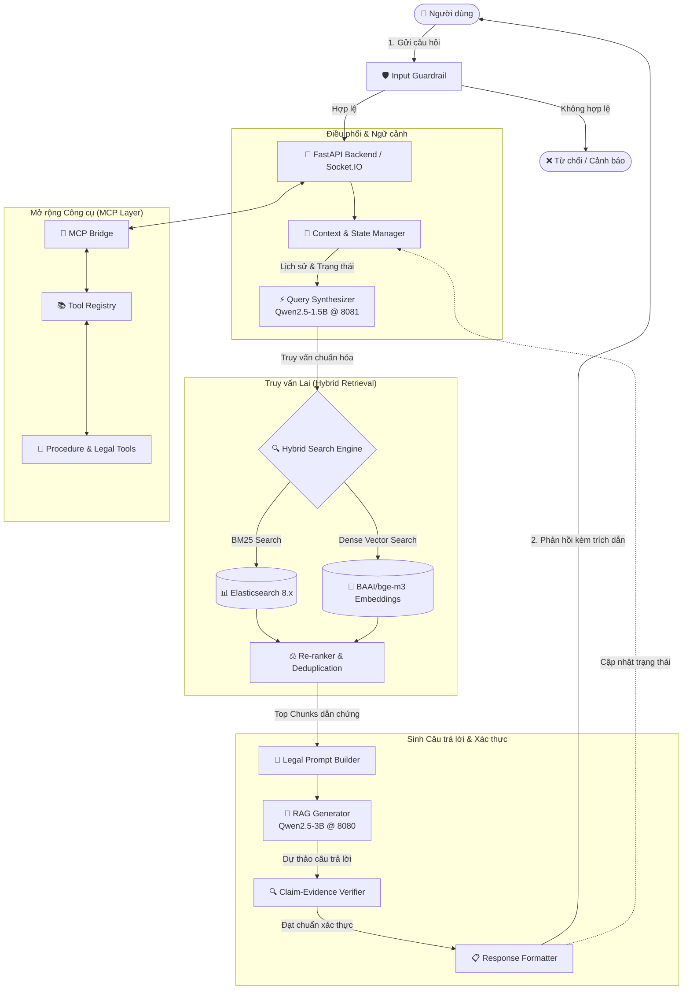

# 🏛️ LLM Administrative Procedures

> **Hệ thống Trợ lý Pháp lý & Thủ tục Hành chính Thông minh ứng dụng Mô hình Ngôn ngữ Lớn (LLM) và Kỹ thuật Retrieval-Augmented Generation (RAG).**

[](https://www.python.org/)
[](https://fastapi.tiangolo.com/)
[](https://www.elastic.co/)
[](https://github.com/ggerganov/llama.cpp)
[](https://opensource.org/licenses/MIT)

---

## 📖 Giới thiệu Dự án

**LLM Administrative Procedures** là hệ thống hỗ trợ công dân, cán bộ và doanh nghiệp tra cứu, giải đáp các thắc mắc về quy trình, hồ sơ, cơ quan thực hiện và căn cứ pháp lý của các thủ tục hành chính tại Việt Nam.

Hệ thống kết hợp giữa tìm kiếm lai (**Hybrid Search**: BM25 + Dense Vector), điều phối đa tác nhân qua giao thức **Model Context Protocol (MCP)**, và quản lý ngữ cảnh hội thoại đa lượt (**Multi-turn Context Management**). Nhờ đó, câu trả lời do hệ thống cung cấp luôn đạt độ chính xác cao, bám sát văn bản pháp quy hiện hành, có dẫn chứng rõ ràng và hạn chế tối đa hiện tượng "ảo giác" (hallucination) thường gặp ở các LLM thông thường.

---

## ✨ Tính năng Nổi bật

- **🔍 Truy vấn Lai Đa Tầng (Hybrid Retrieval & Re-ranking)**: Kết hợp sức mạnh tìm kiếm từ khóa chính xác của **BM25 (Elasticsearch)** và tìm kiếm ngữ nghĩa sâu của **Dense Vector Embedding (`bge-m3`)**, đi kèm thuật toán Re-ranking để chọn lọc các đoạn trích dẫn pháp lý phù hợp nhất.
- **💬 Hội thoại Đa Lượt Thông minh (Multi-turn Context Management)**: Tự động trích xuất và duy trì trạng thái thủ tục (`ContextState`), ghi nhớ thông tin người dùng đã cung cấp qua nhiều lượt trò chuyện, chủ động đặt câu hỏi làm rõ nếu người dùng cung cấp thiếu điều kiện tiên quyết.
- **⚡ Tối ưu hóa Truy vấn Tự động (Query Synthesis & Reformulation)**: Sử dụng mô hình chuyên biệt 1.5B để phân tích ngữ cảnh lịch sử, bóc tách đại từ thay thế và tái cấu trúc câu hỏi của người dùng thành truy vấn tìm kiếm chuẩn xác trước khi đưa vào retriever.
- **🛡️ Kiểm soát An toàn & Xác thực Dẫn chứng (Guardrails & Claim Verification)**: 
  - *Input Guardrails*: Lọc bỏ các tấn công prompt injection, phát hiện câu hỏi ngoài phạm vi nghiệp vụ.
  - *Output Verification*: Đối soát từng luận điểm trong câu trả lời sinh ra với tài liệu gốc (Claim-Evidence Matching) trước khi gửi đến người dùng.
- **🔌 Khả năng Mở rộng với MCP (Model Context Protocol)**: Thiết kế phân tầng tách bạch (Client – Registry – Tools) giúp cắm/rút linh hoạt các công cụ tra cứu cơ sở dữ liệu chuyên ngành hoặc tích hợp hệ thống bên ngoài mà không cần sửa đổi mã nguồn cốt lõi.
- **📦 Pipeline Nạp Dữ liệu Tự động (Ingestion Pipeline)**: Hỗ trợ nạp dữ liệu thủ tục có cấu trúc (JSON) và văn bản tự do, tự động chia nhỏ theo ngữ nghĩa (Semantic Chunking), khử trùng lặp (SHA-256 + Cosine Dedup) và đồng bộ chỉ mục vào Elasticsearch & Vector Database.

---

## 🏗️ Kiến trúc Hệ thống (System Architecture)



---

## 🧠 Thông tin Mô hình (Models Used)

Hệ thống được thiết kế theo kiến trúc **Dual-Model** (hai mô hình chuyên biệt hóa theo tác vụ) nhằm tối ưu hóa đồng thời tốc độ phản hồi và chất lượng lập luận:

### 1. Bảng Tổng quan Mô hình

| Mô hình | Định dạng | Vai trò trong Hệ thống | Kích thước Tham số | Context Window | Cổng Dịch vụ |
|---------|-----------|------------------------|--------------------|----------------|--------------|
| **Qwen2.5-3B-Instruct** | GGUF (`Q4_K_M`) | **RAG Generator**: Lập luận pháp lý, tổng hợp tài liệu và sinh câu trả lời hoàn chỉnh kèm căn cứ | 3.09 tỷ (3.09B) | 8,192 tokens | `8080` |
| **Qwen2.5-1.5B-Instruct** | GGUF (`Q4_K_M`) | **Query Synthesizer**: Phân tích lịch sử hội thoại, bóc tách thực thể và tái cấu trúc câu hỏi truy vấn | 1.54 tỷ (1.54B) | 2,048 tokens | `8081` |
| **BAAI/bge-m3** | PyTorch / HF | **Embedding Model**: Chuyển đổi câu hỏi và tài liệu thủ tục thành vector đặc trưng đa ngữ | 568 triệu (568M) | 8,192 tokens | Cục bộ (In-memory) |

---

### 2. Đặc điểm của Mô hình Gốc (Pre-quantization)

#### 🔹 Qwen2.5-3B-Instruct (Alibaba Cloud)
- **Kiến trúc mạng**: Transformer decoder-only hiện đại với kỹ thuật **Grouped Query Attention (GQA)** gồm 16 query heads và 2 key-value heads, giúp giảm thiểu đáng kể dung lượng bộ nhớ dành cho KV Cache khi xử lý ngữ cảnh dài.
- **Kích thước tham số**: ~3.09 tỷ tham số tổng (2.77 tỷ non-embedding parameters), 36 transformer layers, hidden dimension 2048.
- **Cơ chế kích hoạt & Chuẩn hóa**: SwiGLU activation, RMSNorm, và RoPE (Rotary Position Embedding) hỗ trợ context window gốc lên tới 32,768 tokens (có thể mở rộng đến 128k tokens).
- **Dữ liệu huấn luyện**: Được tiền huấn luyện (pre-trained) trên kho ngữ liệu khổng lồ **18 nghìn tỷ tokens (18 Trillion tokens)** đa ngôn ngữ, bao gồm vốn từ vựng và tri thức phong phú về tiếng Việt. Quá trình tinh chỉnh (post-training) trải qua hơn 1 triệu mẫu chỉ dẫn (SFT) và cân chỉnh đa tầng RLHF/DPO.
- **Thế mạnh vượt trội**: Khả năng tuân thủ cấu trúc chỉ thị (instruction-following), sinh định dạng JSON nghiêm ngặt (structured output) và lập luận suy diễn logic vượt trội so với các mô hình cùng phân khúc tham số <7B.

#### 🔹 Qwen2.5-1.5B-Instruct (Alibaba Cloud)
- **Kiến trúc mạng**: Biến thể tinh gọn gồm 28 transformer layers, ~1.54 tỷ tham số, tối ưu hóa cho độ trễ cực thấp (ultra-low latency).
- **Vai trò**: Đảm nhiệm các tác vụ phụ trợ (Query Reformulation, Intent Detection, Clarification Check). Nhờ kích thước nhỏ, mô hình phản hồi gần như tức thì, giải phóng tài nguyên tính toán cho mô hình sinh chính 3B.

#### 🔹 BAAI/bge-m3 (Beijing Academy of Artificial Intelligence)
- Mô hình embedding đa năng tiên tiến hàng đầu hiện nay với 3 đặc tính cốt lõi: **Multi-Linguality** (hỗ trợ hơn 100 ngôn ngữ, đặc biệt xuất sắc với văn bản hành chính tiếng Việt), **Multi-Functionality** (hỗ trợ đồng thời Dense Retrieval, Lexical/Sparse Matching, và Multi-Vector ColBERT), và **Multi-Granularity** (xử lý văn bản từ câu ngắn đến tài liệu dài 8,192 tokens).
- Output: Dense vector 1024 chiều, mang lại độ phân giải ngữ nghĩa cao cho các thuật ngữ pháp lý chuyên ngành.

---

### 3. Phân tích Kỹ thuật: Mô hình Lượng tử hóa Q4_K_M vs Mô hình Gốc (FP16)

Hệ thống sử dụng kỹ thuật lượng tử hóa **Q4_K_M** (4-bit Medium K-Quant) thông qua định dạng GGUF của `llama.cpp` để triển khai cục bộ:

| Tiêu chí So sánh | Mô hình Gốc (FP16 / BF16) | Lượng tử hóa Q4_K_M (Đang dùng) | Mức độ Thay đổi & Nhận xét |
|------------------|---------------------------|----------------------------------|---------------------------|
| **Độ chính xác lưu trữ** | 16-bit floating point (2 bytes/tham số) | Kết hợp 4-bit & 6-bit (trung bình ~4.5 bits/tham số) | Giảm **~72%** số bit biểu diễn mỗi trọng số |
| **Dung lượng File Model (3B)** | ~6.20 GB | **~1.71 GB** | **Giảm 72.4%** dung lượng ổ cứng lưu trữ |
| **Dung lượng File Model (1.5B)** | ~3.10 GB | **~0.94 GB** | **Giảm 69.7%** dung lượng ổ cứng lưu trữ |
| **Dung lượng RAM tối thiểu** | 12 – 16 GB VRAM/RAM | **~4 GB RAM** (cho cả 2 models) | Có thể chạy mượt trên máy tính cá nhân thông thường |
| **Bảo toàn Chất lượng (Accuracy)** | 100% (Mốc chuẩn gốc) | **97.5% – 99.0%** năng lực gốc | Chỉ số Perplexity chỉ tăng nhẹ (~0.05 - 0.15 PPL), sai số không đáng kể |
| **Tốc độ Suy luận trên CPU** | Chậm (nghẽn băng thông nạp dữ liệu) | **Nhanh gấp 2 – 3 lần** trên CPU | Băng thông bộ nhớ được giải phóng vì lượng dữ liệu cần nạp ít hơn 4 lần |
| **Khả năng tuân thủ JSON/Schema**| Rất tốt | Rất tốt (được bảo toàn nhờ 6-bit ở các trọng số trọng yếu) | Không bị lỗi cú pháp JSON trong quá trình sinh cấu trúc |

#### 🔍 Cơ chế hoạt động của Q4_K_M:
Khác với lượng tử hóa 4-bit đồng nhất thông thường (`Q4_0` - biến toàn bộ trọng số thành 4-bit dẫn đến suy giảm chất lượng ở các tầng quan trọng), phương pháp **K-Quant Medium (`Q4_K_M`)** áp dụng chiến lược phân bổ bit thích ứng:
- Các ma trận trọng số ảnh hưởng quyết định đến khả năng chú ý và suy luận logic (`attention.wv`, `attention.wo`, và các tầng feed-forward then chốt) được lượng tử hóa ở mức **6-bit (`Q6_K`)**.
- Các ma trận trọng số ít nhạy cảm hơn được biểu diễn ở mức **4-bit (`Q4_K`)**.

#### 🎯 Kết quả thực tế trong bài toán RAG:
- **Hiện tượng suy giảm (Loss)**: Trên các tác vụ toán học lý thuyết cực kỳ phức tạp hoặc suy luận đa bước trừu tượng không có ngữ cảnh, mô hình 4-bit có thể có độ trôi nhẹ so với FP16. 
- **Trong hệ thống RAG Thủ tục Hành chính**: Do toàn bộ căn cứ pháp lý, điều kiện và hồ sơ đã được retriever tìm kiếm chính xác và đưa trực tiếp vào context prompt, mô hình chỉ cần thực hiện tác vụ đọc hiểu (reading comprehension), trích xuất và diễn giải. Do đó, **Q4_K_M cho kết quả chính xác tương đương 99% so với FP16**, trong khi tiết kiệm hơn 70% bộ nhớ và cho tốc độ phản hồi nhanh hơn đáng kể trên môi trường CPU không có GPU chuyên dụng.

---

## 💻 Yêu cầu Hệ thống (Prerequisites)

- **Hệ điều hành**: Windows 10/11, macOS, hoặc Linux (Ubuntu 20.04 trở lên).
- **Python**: Phiên bản **`Python 3.12.x`** *(Lưu ý: Luôn sử dụng lệnh `py -3.12` trên Windows nếu máy tính cài đặt nhiều phiên bản Python song song)*.
- **Elasticsearch**: Phiên bản **`8.x`** (Khởi chạy qua Docker hoặc cài đặt cục bộ tại port `9200`).
- **Trình suy luận GGUF**: `llama-server` (từ `llama.cpp`) hoặc `Ollama`.
- **Phần cứng khuyến nghị**:
  - RAM: Tối thiểu 8 GB (Khuyến nghị **16 GB** để chạy đồng thời cả 2 LLM servers, Elasticsearch và Backend API).
  - Ổ cứng: Trống tối thiểu **10 GB** (chứa mô hình GGUF, cache embeddings và dữ liệu index).

---

## 🛠️ Hướng dẫn Cài đặt (Installation)

### Bước 1: Sao chép mã nguồn (Clone Repository)
```bash
git clone https://github.com/your-username/LLM_Administrative_Procedures.git
cd LLM_Administrative_Procedures
```

### Bước 2: Thiết lập Môi trường Ảo (Virtual Environment)
Sử dụng chính xác **Python 3.12**:
```bash
# Windows
py -3.12 -m venv .venv
.venv\Scripts\activate

# Linux / macOS
python3.12 -m venv .venv
source .venv/bin/activate
```

### Bước 3: Cài đặt Thư viện Phụ thuộc (Dependencies)
```bash
pip install --upgrade pip
pip install -r requirements.txt
```

### Bước 4: Tải Trọng số Mô hình GGUF
Tạo thư mục `model/` ở thư mục gốc dự án và tải 2 mô hình GGUF chuẩn:
```bash
mkdir model
```
Tải các file sau và đặt vào thư mục `model/`:
- `Qwen2.5-3B-Instruct-Q4_K_M.gguf` (từ Hugging Face: `Qwen/Qwen2.5-3B-Instruct-GGUF`)
- `Qwen2.5-1.5B-Instruct-Q4_K_M.gguf` (từ Hugging Face: `Qwen/Qwen2.5-1.5B-Instruct-GGUF`)

### Bước 5: Cấu hình Biến Môi trường (.env)
Tạo file `.env` tại thư mục gốc từ mẫu:
```bash
cp .env.example .env  # Hoặc copy .env.example .env trên Windows PowerShell
```

---

## ⚙️ Cấu hình Hệ thống (.env)

Các biến môi trường chính điều khiển hoạt động của hệ thống:

```ini
# --- Cấu hình Server ---
PORT=8000
HOST=0.0.0.0
DEBUG=False

# --- Elasticsearch ---
ELASTICSEARCH_URL=http://localhost:9200
ELASTICSEARCH_INDEX=legal_procedures
ELASTIC_USER=elastic
ELASTIC_PASSWORD=your_password_here

# --- LLM Endpoints (llama-server hoặc Ollama) ---
MODEL_3B_URL=http://localhost:8080/v1
MODEL_1_5B_URL=http://localhost:8081/v1
LLM_TIMEOUT=60

# --- Embedding & Retrieval ---
EMBEDDING_MODEL=BAAI/bge-m3
TOP_K_RETRIEVAL=5
RERANK_TOP_N=3

# --- Quản lý Ngữ cảnh & CSDL ---
DB_URL=sqlite:///./context.db
SESSION_EXPIRE_HOURS=24
MAX_HISTORY_TURNS=5
```

---

## 🚀 Khởi động Nhanh (Quick Start)

### 1. Khởi động Elasticsearch
Đảm bảo Elasticsearch đang chạy tại cổng mặc định `9200`:
```bash
# Ví dụ chạy nhanh bằng Docker
docker run -d --name es-legal -p 9200:9200 -e "discovery.type=single-node" -e "xpack.security.enabled=false" elasticsearch:8.11.0
```

### 2. Khởi động 2 LLM Servers (Inference)
Sử dụng `llama-server` (llama.cpp) để chạy 2 mô hình tại 2 cổng riêng biệt:

**Terminal 1 — Generator (Port 8080):**
```bash
llama-server -m model/Qwen2.5-3B-Instruct-Q4_K_M.gguf --port 8080 -c 8192 -ngl 0
```

**Terminal 2 — Synthesizer (Port 8081):**
```bash
llama-server -m model/Qwen2.5-1.5B-Instruct-Q4_K_M.gguf --port 8081 -c 2048 -ngl 0
```
*(Ghi chú: Đặt `-ngl 0` nếu chạy hoàn toàn trên CPU; nếu máy có GPU NVIDIA, tăng `-ngl 33` để đưa layers lên VRAM).*

### 3. Nạp Dữ liệu Thủ tục Ban đầu (Data Ingestion)
Chạy script nạp tài liệu mẫu vào cơ sở dữ liệu và chỉ mục:
```bash
py -3.12 -m ingestion.pipeline --data-dir ./data/procedures
```

### 4. Khởi chạy Backend FastAPI Server
```bash
py -3.12 backend/main.py
```
Server sẽ sẵn sàng tiếp nhận yêu cầu tại: `http://localhost:8000`

---

## 📡 Tài liệu API (API Reference)

Hệ thống cung cấp giao diện Swagger UI trực quan tại: `http://localhost:8000/docs`

### Các Endpoints Chính:

| Giao thức | Phương thức | Endpoint | Mô tả chức năng |
|-----------|-------------|----------|-----------------|
| **REST**  | `POST` | `/api/chat/message` | Gửi câu hỏi thủ tục; nhận câu trả lời RAG có trích dẫn |
| **REST**  | `GET`  | `/api/chat/sessions` | Lấy danh sách các phiên hội thoại của người dùng |
| **REST**  | `POST` | `/api/chat/sessions` | Khởi tạo một phiên trò chuyện mới |
| **REST**  | `GET`  | `/api/chat/sessions/{id}` | Lấy chi tiết lịch sử và ngữ cảnh của phiên |
| **REST**  | `POST` | `/api/ingestion/upload` | Tải lên tài liệu quy trình/thủ tục mới (JSON/PDF/DOCX) |
| **REST**  | `GET`  | `/api/ingestion/status` | Tra cứu trạng thái tiến độ lập chỉ mục dữ liệu |
| **Socket**| `WS`   | `/socket.io/` | Kênh WebSocket truyền phát câu trả lời dạng Streaming |

#### Ví dụ Request gửi câu hỏi:
```bash
curl -X POST "http://localhost:8000/api/chat/message" \
     -H "Content-Type: application/json" \
     -d '{
       "session_id": "sess_123456",
       "message": "Tôi muốn làm thủ tục đăng ký kết hôn thì cần chuẩn bị những giấy tờ gì?"
     }'
```

---

## 🧰 Tech Stack Chi tiết

| Phân hệ / Tầng chức năng | Công nghệ / Thư viện Sử dụng | Mục đích triển khai |
|--------------------------|------------------------------|---------------------|
| **Ngôn ngữ Lập trình**   | Python 3.12 | Môi trường thực thi tiêu chuẩn của toàn hệ thống |
| **Web API Framework**    | FastAPI, Uvicorn, Python-SocketIO | Cung cấp RESTful endpoints tốc độ cao và luồng streaming thời gian thực |
| **Mô hình Ngôn ngữ Lớn** | Qwen2.5-3B & Qwen2.5-1.5B (GGUF Q4_K_M) | Suy luận pháp lý, sinh câu trả lời và tái cấu trúc truy vấn |
| **Inference Engine**     | llama.cpp (`llama-server`) / Ollama | Trình thực thi mô hình lượng tử hóa tối ưu cho CPU & GPU |
| **Vector Embedding**     | BAAI/bge-m3 (Sentence-Transformers) | Vector hóa ngữ nghĩa đa ngữ 1024 chiều |
| **Full-text Search**     | Elasticsearch 8.x | Đánh chỉ mục và tìm kiếm từ khóa chính xác qua thuật toán BM25 |
| **Lưu trữ Trạng thái**   | SQLite, SQLAlchemy, Pydantic v2 | Quản lý cấu trúc dữ liệu phiên trò chuyện và trạng thái hội thoại |
| **Giao thức Mở rộng**    | Model Context Protocol (MCP) | Chuẩn hóa kết nối giữa LLM và các công cụ tra cứu cơ sở dữ liệu ngoài |
| **Kiểm soát & Đánh giá** | Regex filters, Cosine Dedup, Claim Verifier | Ngăn chặn Prompt Injection và kiểm tra đối soát dẫn chứng chống ảo giác |

---

## 📁 Cấu trúc Thư mục Dự án (Project Structure)

```
LLM_Administrative_Procedures/
├── backend/                  # Tầng Web Server FastAPI và API Routers
│   ├── api/                  # Endpoints: chat, ingestion, sessions, socket
│   ├── services/             # AI service, Context service, Queue service
│   └── main.py               # Điểm khởi chạy chính của backend
├── rag/                      # Tầng lõi RAG Pipeline
│   ├── synthesizer.py        # Tái cấu trúc truy vấn (1.5B model)
│   ├── retrieval.py          # Tìm kiếm lai (BM25 + Dense vector)
│   ├── rerank.py             # Sắp xếp và chấm điểm lại kết quả
│   ├── prompt_builder.py     # Lắp ráp prompt kèm trích dẫn văn bản pháp lý
│   ├── generator.py          # Sinh câu trả lời qua mô hình 3B
│   ├── verification.py       # Kiểm định claim-evidence, loại bỏ ảo giác
│   ├── mapper.py             # Ánh xạ các trường dữ liệu thủ tục
│   └── ...                   # Readers & trích xuất ngữ cảnh bổ trợ
├── context/                  # Quản lý Ngữ cảnh và Trạng thái Hội thoại
│   ├── context_service.py    # Dịch vụ cập nhật và khôi phục ngữ cảnh đa lượt
│   ├── models.py             # Mô hình CSDL (Session, Message, ContextState)
│   ├── state.py              # Định nghĩa schema trạng thái thủ tục
│   └── database.py           # Kết nối và khởi tạo CSDL SQLite
├── domains/                  # Hỗ trợ Đa Lĩnh vực (Multi-domain Routing)
│   ├── runtime.py            # Quản lý domain đang kích hoạt
│   └── domain_loader.py      # Tự động nạp cấu hình domain từ file YAML
├── ingestion/                # Pipeline Xử lý và Nạp Dữ liệu Thủ tục
│   ├── pipeline.py           # Điều phối luồng nạp dữ liệu đầu-cuối (E2E)
│   ├── chunker.py            # Phân đoạn văn bản pháp lý theo ngữ nghĩa
│   ├── embedder.py           # Tạo vector đại diện với bge-m3
│   ├── vector_store.py       # Quản lý chỉ mục vector cục bộ
│   ├── elastic_store.py      # Giao tiếp và lập chỉ mục trên Elasticsearch
│   ├── dedup.py              # Khử trùng lặp văn bản (SHA-256 & Cosine)
│   └── schema_validator.py   # Kiểm tra tính chuẩn hóa của dữ liệu đầu vào
├── guardrails/               # Lớp Bảo vệ An toàn Thông tin
│   ├── input.py              # Phát hiện prompt injection, lọc câu hỏi lạc đề
│   ├── output.py             # Kiểm duyệt độ an toàn của phản hồi
│   └── risk.py               # Phân loại mức độ rủi ro câu hỏi
├── mcp_layer/                # Giao thức Tích hợp Công cụ (MCP)
│   ├── bridge.py             # Cầu nối trung gian giữa RAG và MCP
│   ├── client.py             # MCP Client kết nối tool servers
│   ├── registry.py           # Sổ đăng ký công cụ tập trung
│   └── tools/                # Định nghĩa các tool tra cứu thủ tục hành chính
├── model/                    # Thư mục chứa weights GGUF (được gitignore)
├── task/                     # Tài liệu tác vụ nội bộ, plan và báo cáo (được gitignore)
├── my_config.py              # File tham số cấu hình tập trung của dự án
├── requirements.txt          # Danh mục thư viện Python yêu cầu
└── README.md                 # Tài liệu hướng dẫn dự án (tài liệu này)
```

---

## ⚠️ Hạn chế Đã biết & Kế hoạch Phát triển (Known Limitations & Roadmap)

### Hạn chế Hiện tại:
1. **Quản lý Process Thủ công**: Hiện tại cần khởi chạy riêng biệt 2 tiến trình `llama-server` và tiến trình Elasticsearch trước khi bật backend.
2. **Độ phụ thuộc Dữ liệu**: Độ chính xác của các bước thủ tục phụ thuộc hoàn toàn vào mức độ cập nhật của các văn bản quy phạm pháp luật được nạp vào cơ sở dữ liệu.
3. **Bộ nhớ RAM**: Mặc dù đã dùng lượng tử hóa Q4_K_M, hệ thống vẫn cần tối thiểu 8GB RAM thực tế để toàn bộ các dịch vụ vận hành ổn định song song.

### Kế hoạch Phát triển Tiếp theo (Roadmap):
- [ ] **Đóng gói Docker Compose Một Bước**: Tạo file `docker-compose.yml` tích hợp sẵn Elasticsearch, 2 LLM instances và Backend API chỉ với một câu lệnh `docker compose up`.
- [ ] **Giao diện Người dùng Hiện đại (Web Chat UI)**: Xây dựng giao diện web chat trực quan (React / TailwindCSS) hỗ trợ hiển thị trực quan các bước thủ tục, biểu mẫu tải về và trích dẫn điều luật.
- [ ] **Tích hợp Thêm MCP Tools**: Bổ sung công cụ tra cứu tự động Văn bản Quy phạm Pháp luật Quốc gia và cổng Dịch vụ Công Quốc gia theo thời gian thực.
- [ ] **Hỗ trợ Đa Phương thức**: Tích hợp Speech-to-Text (Whisper) để người dân có thể hỏi-đáp trực tiếp bằng giọng nói.

---

## 📄 Bản quyền (License)

Dự án được phân phối dưới giấy phép mã nguồn mở **MIT License**. Chi tiết xem tại file `LICENSE`.
