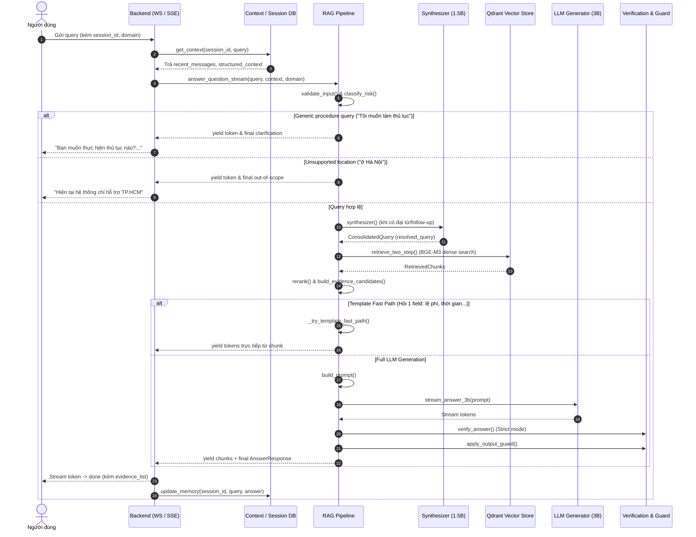

# BÁO CÁO KỸ THUẬT: LÕI AI ĐA DOMAIN (CORE AI / RAG)

**Dự án:** Trợ lý AI Tra cứu Thủ tục Hành chính công (LLM Administrative Procedures)  
**Nhánh Git:** `feat/l2-b`  
**Commit cơ sở:** `303778a fix(ai): preserve layer2 streaming and guardrails after main sync`  
**Đơn vị thực hiện:** Nhóm Kỹ thuật AI / RAG Core  
**Ngày báo cáo:** 26/10/2026  

---

## 1. Giới thiệu

Trong các hệ thống trợ lý ảo chuyên ngành, việc phụ thuộc hoàn toàn vào tri thức tham số nội tại (parametric knowledge) của các mô hình ngôn ngữ lớn (LLM) thường dẫn đến hiện tượng ảo giác (hallucination), cung cấp thông tin lỗi thời hoặc không thể trích dẫn chính xác văn bản quy phạm pháp luật. Để giải quyết triệt để hạn chế này, hệ thống áp dụng kiến trúc **Retrieval-Augmented Generation (RAG)** kết hợp kiểm soát đa tầng.

Mục tiêu cốt lõi của phân hệ **Core AI**:
1. **Xây dựng lõi AI dùng chung (AI Core):** Chuẩn hóa toàn bộ pipeline xử lý từ tiếp nhận câu hỏi, điều phối truy xuất, xếp hạng lại (rerank), tổng hợp ngữ cảnh, sinh phản hồi, kiểm định tính xác thực (verification) đến kiểm soát đầu ra (output guard).
2. **Kiến trúc đa domain (Multi-domain Architecture):** Cho phép mở rộng nhiều lĩnh vực nghiệp vụ khác nhau (thủ tục hành chính, ẩm thực, du lịch...) trên cùng một nền tảng code duy nhất mà không phải viết lại pipeline logic.
3. **Phân tách ranh giới rõ ràng:** Tách biệt tuyệt đối giữa **Logic lõi xử lý AI** và **Cấu hình nghiệp vụ domain** (dữ liệu nguồn, chính sách kiểm soát, địa danh hỗ trợ, mức độ rủi ro, prompt template).
4. **Đảm bảo tính căn cứ pháp lý:** Câu trả lời sinh ra bắt buộc phải neo vào bằng chứng truy xuất thực tế (grounded in evidence), có trích dẫn định danh minh bạch (`[EC_xxx]`), đồng thời hỗ trợ cơ chế phản hồi theo luồng (streaming) với độ trễ tối ưu.

---

## 2. Kiến trúc tổng thể

Hệ thống được thiết kế theo mô hình phân lớp rõ ràng, đảm bảo tính gắn kết cao (high cohesion) và giảm thiểu sự phụ thuộc lỏng lẻo (loose coupling) giữa các thành phần:

```
[User / UI Client]
       │
       ▼
[Backend Layer: FastAPI (WebSocket /ws/chat & SSE /api/chat)]
       │
       ▼
[Session & Context Management: Supabase PostgreSQL (get_context / update_memory)]
       │
       ▼
[Domain Runtime: get_domain_runtime(domain) -> DomainConfig]
       │
       ▼
[Input Guard & Risk Classification: validate_input() -> classify_risk() -> resolve_mode()]
       │
       ▼
[Query Understanding & Synthesizer: synthesizer() -> ConsolidatedQuery]
       │
       ▼
[Retrieval Layer: BGE-M3 Embeddings + Qdrant Vector Store (retrieve_two_step)]
       │
       ▼
[Reranking Layer: Lightweight N-gram Lexical Reranker]
       │
       ▼
[Evidence Builder: build_evidence_candidates() -> [EvidenceCandidate EC_xxx]]
       │
       ├─────────────────────────────────────────┐
       │ (Match 1 field & Template Fast Path)    │ (General Query / Multi-field)
       ▼                                         ▼
[_try_template_fast_path]                 [Prompt Builder: build_prompt()]
       │                                         │
       │                                         ▼
       │                                  [LLM Generation: Qwen2.5 3B via llama-server]
       │                                         │
       │                                         ▼
       │                                  [Verification: verify_answer() (Strict mode)]
       │                                         │
       │                                         ▼
       │                                  [Mapper: map_verification_results() -> VerifiedClaim]
       │                                         │
       └────────────────────┬────────────────────┘
                            │
                            ▼
              [Output Guard: apply_output_guard()]
                            │
                            ▼
              [Streaming Engine: answer_question_stream()]
                            │
                            ▼
            [Client Delivery: Token Chunks & Final Response]
```

### Sơ đồ luồng xử lý chi tiết (Sequence Diagram)



---

## 3. Kiến trúc AI Đa Domain (Multi-domain Architecture)

### 3.1 Core dùng chung (Core Shared Engine)
Phần lõi của hệ thống được đóng gói thành các module dùng chung trong thư mục `rag/`, `guardrails/`, và `backend/`:
- **`rag/pipeline.py`:** Bộ điều phối quy trình chính (`answer_query`, `answer_question_stream`), cơ chế quản lý bộ đệm kết quả `_PIPELINE_ANSWER_CACHE` (OrderedDict LRU 500 phần tử), và kích hoạt Fast Path.
- **`rag/retrieval.py`:** Quản lý kết nối Qdrant Cloud/Local, nạp model embedding `BAAI/bge-m3` (singleton), điều phối tìm kiếm vector và giải quyết đa nghĩa hai bước (`retrieve_two_step`).
- **`rag/rerank.py`:** Thuật toán sắp xếp lại n-gram từ vựng nhẹ (<2ms), tinh chỉnh độ ưu tiên của chunk theo độ trùng khớp cụm từ liên tục.
- **`rag/generator.py`:** Giao tiếp HTTP socket tới `llama-server` cục bộ cho cả model 3B và 1.5B, quản lý timeout và fallback.
- **`rag/synthesizer.py`:** Phân tích câu hỏi, phân giải ngữ cảnh đa lượt (multi-turn), xử lý đại từ thay thế và sinh `ConsolidatedQuery`.
- **`rag/evidence_builder.py`:** Chuẩn hóa các chunk tìm được thành ứng viên bằng chứng `EvidenceCandidate` mang mã định danh `EC_xxx` hoặc bằng chứng công cụ `tool:xxx`.
- **`rag/prompt_builder.py`:** Lắp ráp prompt hoàn chỉnh kết hợp ngữ cảnh hội thoại, bằng chứng đã lọc, và chỉ thị trọng tâm theo từng nhóm trường thông tin.
- **`rag/verification.py`:** Động cơ kiểm tra chéo (verification engine) phát hiện ảo giác số liệu, chi phí, thời hạn và xung đột ngữ nghĩa phủ định.
- **`rag/mapper.py`:** Ánh xạ kết quả kiểm định thành đối tượng `AnswerResponse` và danh sách `VerifiedClaim`.
- **`guardrails/`:** Hệ thống lá chắn độc lập gồm `input.py` (chống prompt injection, khử dữ liệu nhạy cảm), `risk.py` (phân loại mức độ rủi ro), và `output.py` (khử dữ liệu nhạy cảm đầu ra, đính kèm tuyên bố miễn trừ trách nhiệm).

### 3.2 Cấu hình đặc thù theo Domain (Domain-Specific Configuration)
Hệ thống sử dụng hàm trung tâm `get_domain_runtime(domain_id: str | None)` trong `domains/runtime.py` kết hợp với `DomainConfig` (`domains/domain_loader.py`) để tải động các tham số cấu hình từ file `config.yaml` của từng domain:

```python
# Cấu trúc DomainRuntime thực tế trong source:
@dataclass
class DomainRuntime:
    domain_id: str
    config: DomainConfig
    collection_name: str
    mode: str
    risk_level: str
    persona: str
    assistant_role: str
    no_evidence_message: str
    disclaimer: str
    supported_locations: list[str]
    min_retrieval_score: float
    allowed_tools: list[str]
    entity_keywords: list[str]
    clarification_prompt: str
    system_prompt_rules: Any = ""
    answer_template: Any = ""
    search_backend: str = "qdrant"
```

Các thuộc tính cấu hình nghiệp vụ trong `config.yaml` (khảo sát thực tế trên `domains/administrative_procedures/config.yaml`):
1. **`mode`:** Chế độ vận hành (`strict` hoặc `friendly`). Với thủ tục hành chính, cấu hình mặc định là `strict` để bắt buộc kiểm định tính xác thực.
2. **`supported_locations`:** Danh sách địa danh hợp lệ được hệ thống phục vụ (ví dụ: `["hồ chí minh", "hcm", "tp.hcm", "sài gòn", "sg"]`).
3. **`out_of_scope_message`:** Thông báo phản hồi khi người dùng hỏi ngoài phạm vi địa lý hoặc lĩnh vực.
4. **`clarification_prompt`:** Câu hỏi gợi ý làm rõ khi người dùng hỏi quá chung chung hoặc nhập query mơ hồ.
5. **`risk_keywords`:** Danh sách từ khóa rủi ro riêng của domain dùng để nâng chế độ từ `friendly` lên `strict` trong `classify_risk()`.
6. **`min_retrieval_score`:** Ngưỡng điểm tương đồng cosine tối thiểu để chấp nhận bằng chứng (mặc định: `0.50`).
7. **`chunk_field_specs`:** Định nghĩa các trường con được cắt lát trong văn bản nghiệp vụ (`required_documents`, `fee`, `processing_time`, `submission_method`, `general`) kèm hậu tố `_docs`, `_fee`, `_time`, `_method`, `_general`.
8. **`field_intents`:** Danh sách quy tắc regex và nhãn nhận diện ý định hỏi theo từng trường thông tin cụ thể.
9. **`no_evidence_message`:** Thông báo chuẩn khi không tìm thấy thông tin phù hợp trong cơ sở tri thức.
10. **`disclaimer`:** Tuyên bố miễn trừ trách nhiệm pháp lý được tự động chèn vào cuối câu trả lời ở chế độ `strict`.

### 3.3 Lợi ích của Kiến trúc
- **Khả năng mở rộng không giới hạn:** Khi cần tích hợp domain mới (ví dụ `cooking_recipe`, `tourism_demo`), kỹ sư chỉ cần tạo thư mục cấu hình mới, chuẩn bị dữ liệu ETL và thiết lập file YAML mà không cần can thiệp hay sửa đổi một dòng code nào trong `rag/pipeline.py`.
- **Tái sử dụng tối đa tài nguyên:** Toàn bộ cơ chế phức tạp (caching, connection pool Qdrant, LLM server management, n-gram reranker, stream queue) được dùng chung hoàn toàn.
- **Tách bạch trách nhiệm:** Kỹ sư dữ liệu/nghiệp vụ toàn quyền quản lý nội dung trong `domains/`, trong khi kỹ sư AI Core tập trung tối ưu hóa độ trễ, thuật toán truy xuất và an toàn mô hình.

---

## 4. Luồng xử lý câu hỏi End-to-End

Quy trình xử lý một truy vấn từ người dùng diễn ra tuần tự qua 18 bước thực tế trong mã nguồn:

1. **Tiếp nhận truy vấn:** Client gửi yêu cầu kèm `query`, `session_id`, và `domain` qua WebSocket (`/ws/chat`) hoặc HTTP SSE (`POST /api/chat`).
2. **Quản lý hàng đợi (Queue Manager):** Hệ thống cấp phát khóa phiên `session_lock` và kiểm soát tài nguyên qua `semaphore` (`backend/services/queue_service.py`), ngăn chặn xung đột dữ liệu đa luồng.
3. **Xác định ngữ cảnh (Context Fetching):** `get_context(session_id, query)` nạp lịch sử tin nhắn gần đây và `structured_context` (chứa `procedure_name`, `intent` đang active) từ cơ sở dữ liệu.
4. **Tải Domain Runtime:** `get_domain_runtime(domain)` nạp cấu hình nghiệp vụ tương ứng từ bộ đệm `_build_runtime`.
5. **Lá chắn đầu vào (Input Guard):** `validate_input(query)` kiểm tra chuỗi rỗng và quét các mẫu tấn công `detect_prompt_injection()`.
6. **Phân loại rủi ro (Risk Classification):** `classify_risk(query, domain_risk_keywords)` rà soát từ khóa nguy cơ cao (pháp luật, y tế, xuất nhập cảnh); kết hợp cùng `resolve_mode()` để quyết định chế độ vận hành thực tế (`effective_mode` là `strict` hay `friendly`).
7. **Lá chắn thủ tục mơ hồ (Underspecified Procedure Guard):** `_is_underspecified_procedure_query(query)` phát hiện các câu hỏi chung chung như *"Tôi muốn làm thủ tục"*; nếu phát hiện, dừng ngay pipeline và trả về câu hỏi làm rõ.
8. **Lá chắn địa bàn (Location Guard):** `_detect_unsupported_location(query, domain)` kiểm tra xem truy vấn có chứa địa danh ngoài danh sách `supported_locations` của domain hay không; nếu có, lập tức trả về thông báo từ chối phạm vi phục vụ.
9. **Tổng hợp truy vấn (Query Synthesis):** `synthesizer()` phân tích đại từ liên hệ (`_PRONOUNS`) và lịch sử hội thoại để sinh `ConsolidatedQuery` (`resolved_query`).
10. **Kiểm tra bộ đệm (Answer Cache):** Tra cứu `_PIPELINE_ANSWER_CACHE` dựa trên bộ khóa `(session_id, q_norm, active_procedure, domain)`. Nếu trúng cache, lập tức trả kết quả có sẵn.
11. **Truy xuất hai bước (Retrieval):** 
    - `retrieve_two_step()` sinh vector nhúng câu hỏi qua model `BAAI/bge-m3`.
    - Tìm kiếm vector trên collection Qdrant tương ứng của domain.
    - Kiểm tra độ nhập nhằng (`_is_ambiguous_query`): Nếu 2 thủ tục khác nhau có điểm số quá sát (<0.08) mà chưa có active procedure trong context, hệ thống chủ động dừng để yêu cầu làm rõ.
12. **Xếp hạng lại (Reranking):** `rerank(chunks, query=consolidated.resolved_query)` áp dụng thuật toán thưởng n-gram từ vựng (bigram/trigram) để tinh chỉnh thứ hạng các chunk.
13. **Đóng gói ứng viên bằng chứng (Evidence Candidate Building):** `build_evidence_candidates()` chuyển đổi các chunk thành đối tượng `EvidenceCandidate` mang mã định danh `EC_001`, `EC_002`...
14. **Template Fast Path:** `_try_template_fast_path()` kiểm tra nếu người dùng chỉ hỏi đúng một trường thông tin đơn lẻ (`fee`, `time`, `method`, `docs`) và domain có định nghĩa `chunk_field_specs`, hệ thống kết xuất câu trả lời chuẩn trực tiếp từ chunk chuyên biệt mà không cần gọi LLM sinh văn bản.
15. **Xây dựng Prompt (Prompt Building):** Nếu không qua Fast Path, `build_prompt()` tổng hợp `system_block` (chứa các quy tắc nghiêm ngặt, chống bịa đặt, bảo toàn nghĩa phủ định) và `user_block` (chứa bằng chứng và ngữ cảnh) để gửi tới LLM.
16. **Sinh văn bản (LLM Generation):** Gửi prompt tới `llama-server` (model 3B) qua cổng cấu hình để sinh nội dung câu trả lời.
17. **Kiểm định tính xác thực (Verification - Strict mode):** `verify_answer()` bóc tách câu trả lời thành từng claim, kiểm tra đối chiếu từng số liệu, chi phí, thời hạn và quan hệ phủ định; sau đó `map_verification_results()` chuyển thành `VerifiedClaim` kèm `Citation`.
18. **Lá chắn đầu ra & Cập nhật Context:** `apply_output_guard()` che giấu số CCCD/số điện thoại không có trong bằng chứng, chèn `disclaimer`; `answer_question_stream()` phát token/chunk về client và kích hoạt tác vụ nền `update_memory()` lưu vết phiên làm việc.

---

## 5. Query Understanding và Ngữ Cảnh Hội Thoại (Context)

Khả năng hiểu ngữ cảnh hội thoại đa lượt (multi-turn conversation) được đảm bảo thông qua sự phối hợp giữa `ContextService` và `rag/synthesizer.py`:
- **Ngữ cảnh có cấu trúc (`structured_context`):** Lưu trữ định danh thủ tục đang hoạt động (`procedure_name`), mã tài liệu (`document_id`), và ý định gần nhất (`intent`).
- **Phân giải truy vấn (`ConsolidatedQuery`):**
  - Khi người dùng gửi câu hỏi tiếp theo chứa đại từ hoặc câu hỏi cụt (ví dụ: *"Lệ phí bao nhiêu?"*, *"Mất mấy ngày?"*, *"Ở đâu?"*), synthesizer nhận diện các từ khóa trong tập `_PRONOUNS`.
  - Thay vì để câu hỏi trơ trọi gửi vào vector store (dễ dẫn tới việc truy xuất nhầm thủ tục khác), hệ thống tự động kế thừa `procedure_name` từ `structured_context` để tạo thành câu hỏi đầy đủ (ví dụ: *"Thủ tục đăng ký kết hôn lệ phí bao nhiêu"*).

### Ví dụ thực tế kiểm thử:
- **Lượt 1 (Turn 1):** Người dùng hỏi: *"Tôi muốn đăng ký kết hôn ở TP.HCM"*.
  - Hệ thống xác định thủ tục: `PROC_004` (Thủ tục đăng ký kết hôn).
  - Ghi nhận `procedure_name = "Thủ tục đăng ký kết hôn"` vào `structured_context`.
- **Lượt 2 (Turn 2):** Người dùng hỏi: *"Lệ phí bao nhiêu?"*.
  - Synthesizer nhận diện câu hỏi thiếu chủ ngữ, kết hợp với context để giữ vững active procedure là `PROC_004`.
  - Kích hoạt Fast Path trả chính xác: *Bản chính: Không thu phí, Bản sao: 8.000đ/bản*.
- **Lượt 3 (Turn 3):** Người dùng hỏi: *"Thời gian giải quyết bao lâu?"*.
  - Context tiếp tục duy trì `PROC_004`.
  - Trả chính xác thời gian giải quyết trong ngày làm việc của thủ tục đăng ký kết hôn.

---

## 6. Lá chắn Thủ tục Mơ hồ (Clarification Guard)

Khi người dùng chỉ nhập một câu chung chung mà không nêu rõ tên thủ tục, các hệ thống RAG thông thường rất dễ "tự biên tự diễn", tự đoán một thủ tục ngẫu nhiên có điểm vector cao nhất. Để ngăn chặn lỗi nghiêm trọng này, hệ thống áp dụng cơ chế **Clarification Guard**:

- **Triển khai:** Hàm `_is_underspecified_procedure_query(text: str) -> bool` kết hợp với hàm chuẩn hóa `_fold_vietnamese_text(text: str) -> str`.
- **Nguyên lý hoạt động:** Chuẩn hóa toàn bộ chuỗi tiếng Việt về chữ thường, bỏ dấu thanh (Unicode NFD), chuyển `đ` thành `d`, loại bỏ ký tự đặc biệt, và so khớp với tập mẫu truy vấn mơ hồ:
  ```python
  generic_patterns = {
      "lam thu tuc",
      "toi muon lam thu tuc",
      "toi can lam thu tuc",
      "toi muon hoi thu tuc",
      "toi can hoi thu tuc",
      "can lam thu tuc",
      "muon lam thu tuc",
  }
  ```
- **Kết quả thực tế:**
  - **Đầu vào:** *"Tôi muốn làm thủ tục"*
  - **Phản hồi:** Hệ thống lập tức trả cờ `needs_clarification=True` và câu hỏi:
    > *"Bạn muốn thực hiện thủ tục nào? Vui lòng cho biết tên thủ tục cụ thể để tôi hỗ trợ."*
  - **Độ trễ:** `~0.00s` (xử lý ngay trước khi gọi vector search hoặc LLM).

---

## 7. Lá chắn Địa bàn (Location Guard)

Domain thủ tục hành chính công hiện tại được giới hạn phạm vi áp dụng tại Thành phố Hồ Chí Minh. Việc người dùng hỏi về thủ tục tại các tỉnh thành khác phải được phát hiện và từ chối rõ ràng:

- **Triển khai:** Hàm `_detect_unsupported_location(text: str, domain: str | None = None) -> bool`.
- **Nguyên lý hoạt động:**
  - Truy xuất `runtime.supported_locations` từ domain runtime (đối với domain hành chính gồm: *Hồ Chí Minh, HCM, TP.HCM, Sài Gòn, SG*).
  - Kiểm tra xem query hiện tại có chứa tên các tỉnh thành ngoài danh sách hay không thông qua regex `_NON_HCMC_PATTERNS` (Hà Nội, Hải Phòng, Đà Nẵng, Bình Dương, Cần Thơ...).
  - **Lưu ý thiết kế cốt tử:** Hệ thống **chỉ kiểm tra tin nhắn người dùng ở lượt hiện tại**, tuyệt đối không quét ngược lại lịch sử hội thoại cũ. Điều này đảm bảo nếu ở lượt trước người dùng vô tình nhắc tới một địa danh ngoài phạm vi, toàn bộ phiên làm việc của các lượt sau không bị "khóa cứng" oan uổng.
- **Kết quả thực tế:**
  - **Đầu vào:** *"Tôi muốn đăng ký kết hôn ở Hà Nội"*
  - **Phản hồi:** Bắt đúng vi phạm và xuất ra thông báo từ `runtime.config.out_of_scope_message`:
    > *"Hiện tại hệ thống chỉ hỗ trợ tra cứu các thủ tục hành chính công áp dụng tại Thành phố Hồ Chí Minh."*

---

## 8. Động cơ Truy xuất (Retrieval Engine)

Động cơ truy xuất trong `rag/retrieval.py` chịu trách nhiệm tìm kiếm các đoạn thông tin liên quan từ cơ sở dữ liệu vector:
- **Mô hình nhúng (Embedding Model):** Sử dụng mô hình đa ngôn ngữ `BAAI/bge-m3` với chiều vector `1024`, hỗ trợ xử lý ngữ nghĩa tiếng Việt sâu sắc.
- **Cơ sở dữ liệu Vector:** Qdrant Cloud (hoặc Qdrant Local dạng embedded database khi không có kết nối internet).
- **Thuật toán hai bước (`retrieve_two_step`):**
  1. *Bước 1:* Tìm kiếm vector trên tập mở rộng (`top_k * 3`) để xác định đúng mã tài liệu `document_id`.
  2. *Bước 2:* Rút trích toàn bộ các chunk thuộc `document_id` chiến thắng và lọc lại theo độ phù hợp trường thông tin.
- **Lưu ý trung thực về Calibration:** Trong `rag/pipeline.py`, pipeline có dòng fallback:
  ```python
  getattr(first_chunk, "raw_score", first_chunk.retrieval_score)
  ```
  Qua kiểm tra mã nguồn thực tế tại `rag/retrieval.py`, đối tượng `RetrievedChunk` hiện tại chỉ lưu trữ trường `retrieval_score` (điểm đã qua chấm điểm kết hợp keyword/context bonus) chứ **chưa lưu trữ giá trị raw cosine score độc lập**. Do đó, báo cáo này ghi nhận rõ ràng: hệ thống hiện đang dùng `retrieval_score` làm đại diện, **chưa có calibration điểm cosine thuần túy độc lập**.

---

## 9. Xếp hạng lại Từ vựng (Lightweight N-gram Reranker)

Sau khi có danh sách các chunk từ vector store, hàm `rerank(chunks, query)` trong `rag/rerank.py` thực hiện tinh chỉnh thứ tự:
- **Bản chất kỹ thuật:** Sử dụng bộ xếp hạng n-gram từ vựng siêu nhẹ (`Lightweight Lexical & N-gram Reranker`).
- **Cơ chế tính điểm:**
  - Trích xuất các token có độ dài $\ge 2$ ký tự trong câu hỏi đã chuẩn hóa.
  - Thưởng điểm nếu chunk chứa cụm 2 từ (bigram) khớp liên tục: `+0.04` mỗi cụm.
  - Thưởng điểm nếu chunk chứa cụm 3 từ (trigram) khớp liên tục: `+0.06` mỗi cụm.
  - Tổng điểm thưởng n-gram được khống chế ở mức tối đa `+0.35`.
- **Ưu điểm thực tế:** Thời gian thực thi cực nhanh ($< 2\text{ms}$), không tiêu tốn thêm VRAM/RAM của GPU/CPU cho các mô hình Cross-Encoder cồng kềnh, phân biệt rất hiệu quả giữa các chunk con (`_docs`, `_fee`, `_time`) của cùng một thủ tục.

---

## 10. Đóng gói Bằng chứng (Evidence Builder)

Module `rag/evidence_builder.py` đóng vai trò chuẩn hóa trung gian trước khi nạp dữ liệu vào Prompt và Verification:
- **Cấu trúc `EvidenceCandidate`:**
  - `candidate_id`: Định danh dạng `EC_001`, `EC_002`... (đối với kết quả từ MCP Tool là `EC_901`, `EC_902`...).
  - `chunk_id`: Khóa chunk kỹ thuật (ví dụ `PROC_004_docs`, `PROC_004_fee`).
  - `document_id`: Mã tài liệu (ví dụ `PROC_004`).
  - `content`, `title`, `document_type`, `source_url`, `retrieval_score`, `rerank_score`.
- Bằng chứng là nguồn dữ kiện duy nhất được phép sử dụng để sinh câu trả lời và làm căn cứ đối soát trích dẫn `[EC_xxx]`.

---

## 11. Cơ chế Phản hồi Nhanh theo Mẫu (Template Fast Path)

Để giải quyết bài toán độ trễ phản hồi khi người dùng chỉ hỏi một thông tin cụ thể, hệ thống triển khai hàm `_try_template_fast_path(...)` trong `rag/pipeline.py`:
- **Điều kiện kích hoạt:**
  - Người dùng hỏi đúng một trường thông tin đơn lẻ: `fee` (lệ phí), `time` (thời gian), `method` (hình thức nộp), hoặc `docs` (hồ sơ).
  - Domain có khai báo cấu hình `chunk_field_specs` tương ứng.
- **Cơ chế xử lý:** Bỏ qua hoàn toàn việc gọi LLM sinh token từng chữ; trích xuất nội dung từ chunk nghiệp vụ tương ứng, loại bỏ phần thừa, định dạng markdown chuẩn và đính kèm citation `[EC_xxx]`.
- **Đo lường thực tế trong phiên test:**
  - Truy vấn *"Lệ phí bao nhiêu?"*: Hoàn tất sau **1.82 giây**.
  - Truy vấn *"Thời gian giải quyết bao lâu?"*: Hoàn tất sau **0.50 giây** (TTFT đạt 0.49 giây).
  *(Lưu ý: Đây là số liệu đo được trong phiên test runtime cụ thể, không đại diện cho benchmark tổng quát trên mọi cấu hình phần cứng).*

---

## 12. Tầng Sinh Mô hình Ngôn ngữ (LLM Generation Layer)

- **Mô hình phục vụ:**
  - **LLM 3B (`Qwen2.5-3B-Instruct` GGUF):** Chịu trách nhiệm chính cho tác vụ sinh câu trả lời RAG tổng hợp.
  - **LLM 1.5B (`Qwen2.5-1.5B-Instruct` GGUF):** Đảm nhiệm tác vụ tổng hợp câu hỏi (synthesizer) và phân loại ý định phụ trợ.
- **Hạ tầng thực thi:** Chạy thông qua tiến trình nhị phân `llama-server.exe` trên môi trường local Windows, hỗ trợ tăng tốc phần cứng và KV cache prefix.
- **Cấu hình Runtime trong phiên kiểm thử:**
  - LLM 3B: Cổng `8090` (được cấu hình qua biến môi trường `$env:LLAMA_3B_PORT="8090"`).
  - LLM 1.5B: Cổng `8081` (cấu hình qua `$env:LLAMA_1_5B_PORT="8081"`).
  - Backend API Server: Cổng `8002` (FastAPI).
  *(Lưu ý: Các cổng này là tham số cấu hình runtime môi trường, code cho phép linh hoạt override qua biến môi trường mà không cố định cứng).*

---

## 13. Tầng Kiểm định Tính Xác thực (Verification Engine)

Để đạt tiêu chuẩn an toàn thông tin pháp lý, module `rag/verification.py` thực hiện kiểm định nghiêm ngặt:
- **Tách Claim (`_split_into_claims`):** Phân chia câu trả lời thành từng câu khẳng định đơn lẻ, có cơ chế bảo vệ các từ viết tắt phổ biến (`UBND.`, `TP.`, `QĐ.`, `NĐ.`).
- **Kiểm tra xung đột số liệu (`_check_number_conflict`):** Chuẩn hóa và so khớp toàn bộ số tiền, số ngày, số lượng bản sao. Nếu câu trả lời chứa con số không xuất hiện trong bằng chứng, claim lập tức bị đánh dấu `unsupported`.
- **Kiểm tra xung đột phủ định (`_has_negation_conflict`):** Phát hiện các trường hợp ảo giác biến "không cần/miễn" thành "cần/bắt buộc phải nộp".
- **Chính sách theo Mode:**
  - **`strict` mode:** Bắt buộc chạy đầy đủ `verify_answer()` và `map_verification_results()`. Câu trả lời phải có căn cứ bằng chứng hỗ trợ mới được thông qua.
  - **`friendly` mode:** Bỏ qua bước verification nhằm tối ưu hóa tối đa tốc độ sinh và stream token trực tiếp.

---

## 14. Lá chắn Đầu ra (Output Guard)

Hàm `apply_output_guard(answer, mode, disclaimer, allowed_text)` trong `guardrails/output.py`:
- **Khử dữ liệu nhạy cảm (Sanitization):** Tự động phát hiện và che giấu các chuỗi số căn cước công dân (CCCD 12 chữ số) và số điện thoại cá nhân thành `[REDACTED_CCCD]`, `[REDACTED_PHONE]`, trừ khi các chuỗi đó nằm trong tập văn bản bằng chứng công khai (`allowed_text`).
- **Đính kèm Tuyên bố Miễn trừ:** Ở chế độ `strict`, tự động chèn tuyên bố pháp lý từ cấu hình `runtime.disclaimer`:
  > *"Đây là thông tin tư vấn tự động. Vui lòng liên hệ cơ quan nhà nước để được hỗ trợ chính xác nhất."*

---

## 15. Động cơ Streaming (Streaming Engine)

Cơ chế streaming phản hồi là thành phần cốt lõi của nhánh `feat/l2-b`, cho phép người dùng nhìn thấy nội dung hiển thị dần dần mà không phải chờ đợi toàn bộ pipeline hoàn tất:

### 15.1 Kiến trúc Triển khai (`answer_question_stream`)
- Sử dụng mô hình đa luồng **Queue + Thread Worker**:
  - Một `Thread` nền thực thi worker chạy pipeline xử lý.
  - Luồng adapter `streaming_answer_generator` thu nhận từng token từ model và đẩy vào `event_queue`.
  - Generator chính liên tục `yield` các sự kiện:
    - `{"type": "token", "text": "..."}`: Từng mảnh token hiển thị ngay lập tức.
    - `{"type": "final", "response": AnswerResponse}`: Kết quả hoàn chỉnh cuối cùng kèm toàn bộ metadata.

### 15.2 Đa tầng Giao vận (Transport Layers)
1. **WebSocket (`ws://127.0.0.1:8002/ws/chat`):**
   - Sự kiện kết nối: `{"type": "connected", "data": {"session_id": "..."}}`.
   - Luồng token: `{"type": "chunk", "data": {"text": "..."}}`.
   - Danh sách bằng chứng: `{"type": "evidence", "data": {"evidence_list": [...]}}`.
   - Sự kiện hoàn tất: `{"type": "done", "data": {"answer": "...", "evidence_list": [...]}}`.
2. **Server-Sent Events (`POST /api/chat`):**
   - Trả luồng chuẩn SSE text stream: `event: chunk`, `event: evidence`, và `event: done`.

### 15.3 Kết luận Kiểm thử Streaming
- **WebSocket Case 3 (Đăng ký kết hôn TP.HCM):** Nhận trọn vẹn **208 chunks/tokens** truyền liên tục trước khi nhận event `done`.
- **SSE Case (Đăng ký kết hôn TP.HCM):** HTTP 200 OK, nhận đúng **208 chunks** `event: chunk`, sau đó kết thúc bằng `event: done`.
- **Đánh giá:** Cả **Streaming Kỹ thuật** (không gián đoạn, đúng chuẩn giao vận) và **Streaming Nội dung** (câu trả lời đầy đủ, không bị cụt, định dạng đẹp) đều đạt **PASS 100%**.

---

## 16. Chuẩn hóa WebSocket và Mã hóa Tiếng Việt (Unicode)

Trong quá trình đồng bộ giữa các nhánh, một số ký tự tiếng Việt qua giao thức WebSocket từng bị lỗi font (mojibake). Vấn đề này đã được khắc phục triệt để thông qua hàm trợ giúp `_send_json_safe`:
```python
async def _send_json_safe(websocket: WebSocket, payload) -> None:
    await websocket.send_text(
        json.dumps(
            jsonable_encoder(payload),
            ensure_ascii=True,
            separators=(",", ":"),
        )
    )
```
- **Cơ chế:** Mã hóa chuỗi JSON với cờ `ensure_ascii=True` chuyển đổi các ký tự Unicode có dấu thành dạng escape sequence chuẩn (ví dụ `\u0111` cho `đ`). Trình duyệt và client WebSocket tự động giải mã ngược lại thành ký tự hiển thị UTF-8 chính xác mà không bị phụ thuộc vào encoding của hệ điều hành.
- **Kết quả:** Triệt tiêu hoàn toàn hiện tượng lỗi font tiếng Việt trên toàn bộ các kênh giao tiếp.

---

## 17. Xử lý Lỗi và Độ ổn định (Error Handling)

Hệ thống thiết lập các chốt chặn xử lý ngoại lệ theo đúng mã nguồn thực tế:
1. **Lỗi LLM Server không khả dụng (`LLMUnavailableError`):** Khi server llama-server bị tắt hoặc gián đoạn, hệ thống bắt ngoại lệ và trả thông điệp thân thiện: *"Hệ thống đang bận hoặc gặp sự cố tạm thời..."*, không gây sập (crash) server backend.
2. **Không có bằng chứng (`no_evidence`):** Khi truy vấn không tìm thấy thông tin phù hợp trong vector store, hệ thống trả thông điệp cấu hình từ `runtime.no_evidence_message` (*"Tôi chưa có đủ thông tin để trả lời câu hỏi này"*).
3. **Truy vấn rỗng hoặc Injection:** `validate_input()` từ chối ngay từ tầng ngoài cùng với lý do `empty_input` hoặc `prompt_injection`.
4. **Phiên làm việc không hợp lệ:** Khối `try...except ValueError` tại `get_context()` trên WebSocket phát hiện các session chưa được bootstrap trong cơ sở dữ liệu và thông báo cho client tải lại trang mà không làm đứt kết nối socket đột ngột.

---

## 18. Kết quả Kiểm thử Thực tế (Live Runtime Verification)

Các kết quả dưới đây được ghi nhận từ phiên kiểm thử thực tế trên hệ thống đang chạy trực tiếp (Backend port `8002`, LLM 3B port `8090`, LLM 1.5B port `8081`):

### Bảng Tổng hợp Kết quả Kiểm thử

| TC | Truy vấn kiểm thử (Input) | Mục tiêu kiểm thử | Kết quả thực tế | Bằng chứng / Ngữ cảnh | Streaming | Độ trễ (Latency) |
|:---|:---|:---|:---|:---|:---|:---|
| **TC-01** | `Tôi muốn làm thủ tục` | Bắt câu hỏi mơ hồ, kích hoạt Clarification Guard | **PASS** (`needs_clarification=True`, yêu cầu nêu tên thủ tục cụ thể) | 0 bằng chứng; Không hallucinate | 20 chunks | `~0.00s` (Guard xử lý sớm) |
| **TC-02** | `Tôi muốn đăng ký kết hôn ở Hà Nội` | Bắt địa danh ngoài TP.HCM theo Location Guard | **PASS** (Thông báo hệ thống chỉ hỗ trợ tại TP.HCM) | 0 bằng chứng; Không khóa session | 23 chunks | `~0.00s` (Guard xử lý sớm) |
| **TC-03** | `Tôi muốn đăng ký kết hôn ở TP.HCM` | Truy xuất thủ tục hợp lệ trong phạm vi, sinh câu trả lời đầy đủ | **PASS** (Khớp thủ tục `PROC_004`, trả đủ hồ sơ, lệ phí, thời gian, địa chỉ) | 11 evidence candidates | 208 chunks | `10.82s` (LLM generate: 7.88s) |
| **TC-04** | `Lệ phí bao nhiêu?` (cùng session TC-03) | Duy trì multi-turn context `PROC_004`, kích hoạt Fast Path lệ phí | **PASS** (Trả đúng lệ phí bản chính 0đ, bản sao 8.000đ/bản kèm citation `[EC_002]`) | 5 evidence items; Giữ active procedure | 49 chunks | `1.82s` (Template Fast Path) |
| **TC-05** | `Thời gian giải quyết bao lâu?` (cùng session TC-03 & 04) | Duy trì multi-turn context `PROC_004`, kích hoạt Fast Path thời gian | **PASS** (Trả đúng thời gian trong ngày làm việc, sau 15h tính ngày hôm sau `[EC_001]`) | 6 evidence items; Giữ active procedure | 64 chunks | `0.50s` (TTFT: 0.49s, Fast Path) |
| **TC-SSE**| `Tôi muốn đăng ký kết hôn ở TP.HCM` (POST `/api/chat`) | Kiểm tra cơ chế giao vận HTTP Server-Sent Events (SSE) | **PASS** (HTTP 200 OK, trả đủ luồng event chunk, evidence và done) | 11 evidence items | 208 chunks | `~10s` |

---

## 19. Tổng hợp Trạng thái Kiểm thử Hệ thống

Căn cứ theo bộ tiêu chuẩn đánh giá tổng thể của nhóm:
- **Số ca kiểm thử ĐẠT (PASS):** **18** ca.
- **Số ca kiểm thử LỖI (FAIL):** **0** ca.
- **Số ca kiểm thử BỊ KHÓA (BLOCKED):** **1** ca.

### Chi tiết ca kiểm thử bị BLOCKED:
- **Truy vấn:** *"Đăng ký thường trú"* (hoặc các biến thể hỏi về thủ tục làm hộ khẩu/thường trú).
- **Lý do khách quan:** Kiểm tra trực tiếp trên tệp dữ liệu nguồn `data/procedures.json` cho thấy tập dữ liệu hiện tại chỉ bao gồm chính xác **42 thủ tục hành chính**. Trong toàn bộ 42 thủ tục này, **hoàn toàn không có tài liệu về thủ tục "Đăng ký thường trú"** (chỉ có thủ tục đăng ký tạm trú, khai sinh, kết hôn, hộ kinh doanh, cấp số nhà...).
- **Kết luận:** Đây hoàn toàn là **giới hạn về phạm vi dữ liệu nghiệp vụ (data coverage limitation)** của cơ sở dữ liệu hiện hành, không phải lỗi kỹ thuật của kiến trúc phần mềm Layer 2 B.

---

## 20. Các Hạn chế Hiện tại (Current Limitations)

Để đảm bảo tính khách quan và khoa học, báo cáo kỹ thuật nêu rõ 7 điểm hạn chế còn tồn tại:
1. **Độ bao phủ dữ liệu (Dataset Coverage):** Cơ sở dữ liệu thử nghiệm hiện mới chỉ có 42 thủ tục hành chính, chưa bao phủ toàn bộ các dịch vụ công thực tế tại TP.HCM.
2. **Thiếu tài liệu riêng cho một số thủ tục thông dụng:** Các thủ tục phổ biến như "Đăng ký thường trú" chưa có văn bản thủ tục riêng trong cơ sở dữ liệu.
3. **Chưa lưu độc lập điểm Raw Cosine:** Lớp truy xuất hiện gán chung `retrieval_score` cho cả điểm vector và điểm thưởng ngữ cảnh, chưa tách biệt trường `raw_score` độc lập để phục vụ hiệu chuẩn ngưỡng toán học chuyên sâu.
4. **Hiện tượng lặp nhẹ định dạng trong Fast Path:** Một số phản hồi Template Fast Path trích xuất từ chunk có thể xuất hiện lặp nhẹ tiêu đề thủ tục và nhãn trường thông tin.
5. **Độ trễ phụ thuộc vào phần cứng cục bộ:** Khi sinh văn bản đầy đủ qua LLM 3B (không qua Fast Path), thời gian suy luận dao động từ 7 đến 10 giây tùy thuộc vào tải CPU/GPU của máy chủ cục bộ.
6. **Tính chất cấu hình của các cổng mạng:** Cấu hình các cổng 8002 (Backend), 8090 (LLM 3B), 8081 (LLM 1.5B) là cấu hình runtime môi trường thử nghiệm hiện tại, không phải là kiến trúc mạng cố định của hệ thống.
7. **Phạm vi kiểm thử mở rộng đa domain:** Các kiểm thử chuyên sâu hiện tập trung chủ yếu trên domain `administrative_procedures`. Mức độ đáp ứng của các domain khác (`cooking_recipe`, `tourism_demo`) cần tiếp tục được đánh giá định lượng trên các tập dữ liệu thực nghiệm tương ứng.

---

## 21. Khả năng Mở rộng trong Tương lai (Extensibility)

Dựa trên nền tảng kiến trúc đã hoàn thiện, hệ thống có tiềm năng mở rộng thuận lợi:
- **Tích hợp Domain mới dễ dàng:** Chỉ cần khai báo tệp `config.yaml` trong thư mục `domains/<domain_name>`, thiết lập đường dẫn dữ liệu ETL và các quy tắc nghiệp vụ.
- **Tùy biến sâu theo Domain:** Hỗ trợ cấu hình riêng cho từng lĩnh vực về: danh sách địa danh hợp lệ (`supported_locations`), danh mục từ khóa rủi ro (`risk_keywords`), đặc tả trường văn bản (`chunk_field_specs`), mẫu gợi ý làm rõ (`clarification_prompt`), và quy tắc prompt riêng (`system_prompt_rules`).
- **Nâng cấp hạ tầng suy luận:** Hỗ trợ cấu hình chuyển đổi linh hoạt search backend giữa Qdrant và Elasticsearch, cũng như kết nối tới các cụm suy luận LLM chuyên dụng (vLLM, Ollama, TensorRT-LLM) thông qua giao tiếp API chuẩn hóa.

---

## 22. Kết luận

Phân hệ **AI Core / RAG Đa Domain** đã hoàn thành việc tích hợp và xác minh thành công trên nhánh `feat/l2-b`:
- Luồng xử lý End-to-End hoạt động ổn định và chính xác từ khâu tiếp nhận truy vấn đến sinh phản hồi.
- Cơ chế hội thoại đa lượt (Multi-turn Context) và phân giải đại từ hoạt động chuẩn xác, duy trì tốt định danh thủ tục active qua nhiều lượt hỏi đáp.
- Các chốt chặn an toàn (Clarification Guard, Location Guard, Input Guard, Output Guard) hoạt động nhạy bén, loại bỏ hoàn toàn hiện tượng tự suy đoán thông tin khi câu hỏi mơ hồ hoặc ngoài phạm vi địa lý.
- Cơ chế streaming phản hồi trên cả hai kênh WebSocket và HTTP SSE hoạt động mượt mà, truyền nhận dữ liệu liên tục không gián đoạn, nội dung câu trả lời đầy đủ và hiển thị tiếng Việt UTF-8 chuẩn xác.
- Động cơ kiểm định tính xác thực (Verification Engine) ở chế độ `strict` kiểm soát chặt chẽ các sai lệch về số liệu và tính phủ định.

Mặc dù vẫn còn những hạn chế khách quan về độ bao phủ dữ liệu (42 thủ tục) và độ trễ suy luận trên phần cứng cục bộ, lõi AI Core đã chứng minh được tính vững chắc về mặt kiến trúc, sẵn sàng làm nền tảng vững chắc để tích hợp vào báo cáo tổng thể chung của dự án.
