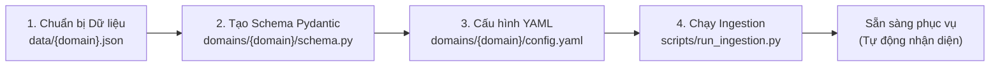

# Hướng Dẫn Onboarding Domain Mới (Zero-Code Domain Onboarding)

Hệ thống RAG hỗ trợ kiến trúc đa miền hoàn toàn độc lập. Bạn có thể thêm bất kỳ miền kiến thức mới nào (ví dụ: *Y tế, Tài chính, Bất động sản, Tuyển dụng, Ẩm thực...*) mà **không cần chỉnh sửa bất kỳ dòng code lõi nào** trong các module RAG (`rag/`), Context (`context/`), hay Guardrails (`guardrails/`).

---

## Quy Trình 4 Bước Đưa Domain Mới Lên Hệ Thống



---

### Bước 1: Chuẩn bị tệp dữ liệu nguồn (`data/<domain_id>.json`)
Tạo tệp JSON chứa danh sách các thực thể/tài liệu của domain. Mỗi tài liệu cần có tối thiểu:
- `document_id`: Định danh duy nhất (ví dụ: `MED001`, `FIN001`, `CD001`).
- `title`: Tiêu đề hoặc tên thực thể.
- `content`: Nội dung chi tiết dùng để tạo vector embedding và làm bằng chứng trả lời.
- Các trường mở rộng tùy chọn: `category`, `location`, `price`, `address`, `source_url`,...

*Ví dụ minh họa (`data/hospital_demo.json`):*
```json
[
  {
    "document_id": "HOSP001",
    "title": "Bệnh viện Chợ Rẫy",
    "category": "Bệnh viện Đa khoa Trung ương",
    "location": "TP HCM",
    "address": "201B Nguyễn Chí Thanh, Phường 12, Quận 5",
    "content": "Bệnh viện Chợ Rẫy là bệnh viện đa khoa tuyến cuối lớn nhất phía Nam, chuyên sâu về cấp cứu, chấn thương và hồi sức..."
  }
]
```

---

### Bước 2: Khai báo Schema Pydantic (`domains/<domain_id>/schema.py`)
Tạo thư mục `domains/<domain_id>/` và tạo tệp `schema.py` định nghĩa lớp kế thừa `pydantic.BaseModel`:

```python
from typing import Optional
from pydantic import BaseModel

class HospitalDocument(BaseModel):
    document_id: str
    title: str
    category: Optional[str] = ""
    location: Optional[str] = None
    address: Optional[str] = None
    content: Optional[str] = None
```

---

### Bước 3: Cấu hình Miền (`domains/<domain_id>/config.yaml`)
Tạo tệp `config.yaml` quy định các tham số hoạt động:

```yaml
domain_id: hospital_demo
domain_name: Cẩm nang Bệnh viện và Cấp cứu
description: Trợ lý tư vấn địa chỉ, chuyên khoa và thông tin các bệnh viện.

# Chế độ: 'strict' (pháp lý/y tế nghiêm ngặt) hoặc 'friendly' (gần gũi, không disclaimer cứng)
mode: strict
risk_level: medium
collection_name: hospital_demo
assistant_role: "chuyên gia y tế cộng đồng"
persona: "Bạn là một trợ lý hướng dẫn cơ sở y tế chu đáo, rõ ràng, luôn lưu ý người dân tìm kiếm sự hỗ trợ chuyên môn khi khẩn cấp."

min_retrieval_score: 0.20
no_evidence_message: "Xin lỗi, tôi chưa tìm thấy thông tin về cơ sở y tế này."
out_of_scope_message: "Khu vực này hiện nằm ngoài phạm vi hỗ trợ của hệ thống y tế."

# Danh sách địa phương hỗ trợ (để trống nếu hỗ trợ toàn quốc)
supported_locations:
  - "TP HCM"
  - "Hà Nội"

# Từ khóa kích hoạt nâng mức rủi ro lên strict ngay lập tức
risk_keywords:
  - "cấp cứu"
  - "ngộ độc"
  - "ngừng thở"
  - "hôn mê"

# Cấu hình chia chunk
chunk_fields:
  - general

chunk_field_specs:
  general:
    suffix: _general
    label: Thông tin chung
    attr: content

# Nguồn dữ liệu
sources:
  - type: json
    path: data/hospital_demo.json
```

---

### Bước 4: Chạy Lệnh Nạp Vector (Ingestion)
Mở terminal và thực thi lệnh nạp tự động bằng script có sẵn:

```bash
# Nạp dữ liệu vào Qdrant
py -3.12 scripts/run_ingestion.py --domain hospital_demo --force
```

Quy trình tự động:
1. Đọc và xác thực cấu trúc dữ liệu theo schema Pydantic.
2. Tạo vector embedding thông qua mô hình `BAAI/bge-m3`.
3. Tự động kiểm tra trùng lặp (similarity deduplication).
4. Khởi tạo collection `hospital_demo` và nạp toàn bộ chunks lên Qdrant Vector Store.

---

## 5. Tự Động Nhận Diện và Kiểm Thử

- **Tự động nhận diện**: Hàm `domains.list_domains()` tự động quét thư mục và nạp domain vào danh sách phục vụ của API.
- **Đánh giá chất lượng**: Bạn có thể tạo thêm tệp `domains/<domain_id>/golden_set.json` và chạy lệnh kiểm thử độ chính xác truy xuất:
  ```bash
  py -3.12 scripts/eval_golden_set.py --domain hospital_demo
  ```
